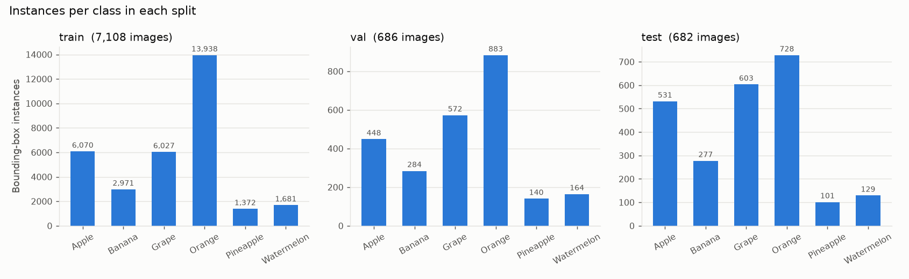
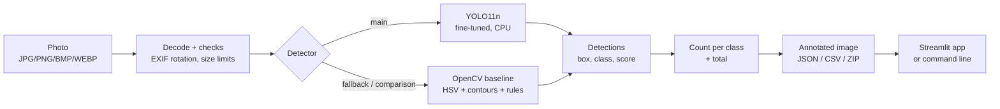
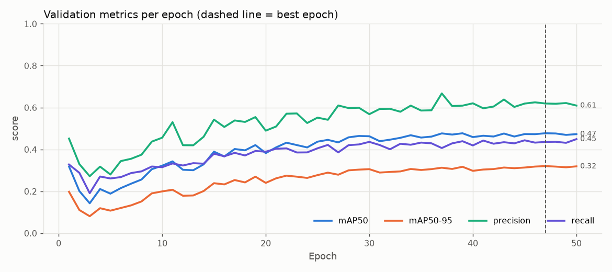
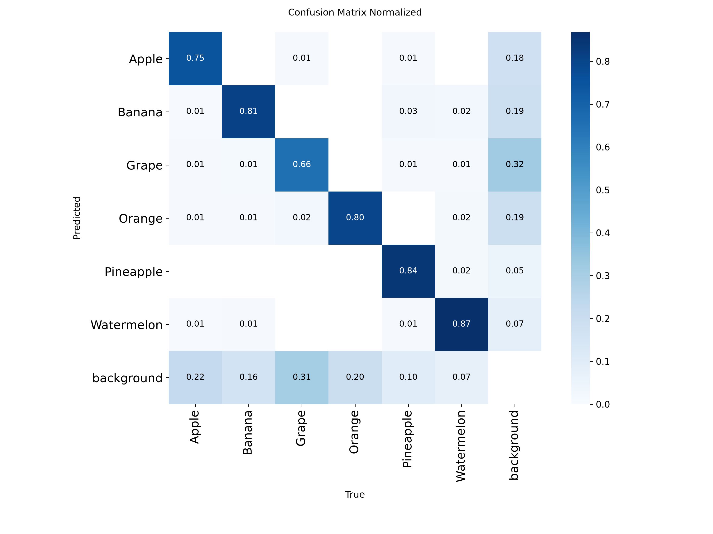

# BOTOTOY 2.0: Fruit Detection and Identification Using YOLO

**Final Project Report** · CSST 106 – Perception and Computer Vision · BSCS 4A · Instructor: Mr. Jeremy Reyes

**Team Bototoy 2.0:** Kyle Angelo D. Mercado · Ian Patrick Z. Mesias · James Paul L. Panal

Version 1.0 · November 2026 ·
Repository: [github.com/imPickleRiick/BOTOTOY-2.0-Fruit-Detection-and-Identification-Using-YOLO](https://github.com/imPickleRiick/BOTOTOY-2.0-Fruit-Detection-and-Identification-Using-YOLO)

---

## Abstract

BOTOTOY 2.0 finds and names six kinds of fruit (apple, banana, grape, orange, pineapple, watermelon) in still
photos. For each fruit it draws a bounding box and gives a class label and a confidence score. It also counts
the fruits per class and in total. The main method is **YOLO11n**, fine-tuned from COCO-pretrained weights on
a public dataset of 8,479 images. A traditional **OpenCV pipeline** (HSV color masks, morphology, contours and
hand-written rules) serves as the comparison baseline and as the fallback.

On a locked, leakage-free test set of 682 photos, YOLO11n reaches **mAP@0.50 = 0.490** and **mAP@0.50:0.95 =
0.338**. That is about 10 times the baseline's mAP@0.50 of 0.049, but below the proposal's targets of 0.80 and
0.50. On plain-background photos, the controlled setting the proposal had in mind, YOLO11n reaches mAP@0.50 =
0.750. The system runs in **69 ms per image on a laptop CPU** (target: ≤ 1 s), passes all 16 end-to-end system
checks, and names the right fruit in 11 of 12 photos from outside the dataset.

An error review of all 1,977 test errors shows that wrong fruit names are rare (2.3%). Most errors come from
crowded scenes whose labels are inconsistent (one box per fruit in some images, one box per group in others)
and from very small fruits.

---

## 1. Problem and scope

Students, small food sellers and households usually identify and count fruit by looking at each item. This is
slow and inconsistent when a photo has many fruits, when fruits overlap, or when lighting and backgrounds change.
A camera-based system can speed up the first inspection. It places a box around every visible fruit and adds a
label and a confidence score, so the user can see exactly which region produced each prediction.

**In scope:** still RGB images, one at a time or in batches. Six classes. Bounding boxes, class labels,
confidence scores, counts per class and in total.
**Out of scope:** video, ripeness, freshness, disease, weight, nutrition and grading.

## 2. Objectives and final results

| Objective (from the proposal) | Target | Final result (locked test set) | Met? |
|---|---|---|---|
| Detect and identify all six classes | mAP@0.50 ≥ 0.80 | **0.490** | ❌ |
| | mAP@0.50:0.95 ≥ 0.50 | **0.338** | ❌ |
| Do not neglect any class | recall ≥ 0.70 for every class | 0.32 (Orange) to 0.68 (Watermelon) | ❌ |
| Report precision, recall and per-class AP | reported | Section 7.1 | ✅ |
| Error review of ≥ 20 false positives / misses | ≥ 20 | 1,977 categorized, 48 inspected by eye ([error review](../outputs/yolo/eval_test/error_review/ERROR_REVIEW.md)) | ✅ |
| Usable visual result: box, label and score per detection, count by class | working | Streamlit app, CLI tools, annotated JPG + JSON/CSV | ✅ |
| Practical speed: mean end-to-end time per 640×640 image, ≥ 50 unseen images | ≤ 1.0 s | **69 ms** on 682 test images (AMD Ryzen 5 5600U, CPU only, batch size 1) | ✅ |
| Minimum fallback: complete OpenCV baseline + data audit + sample outputs | delivered | Baseline is built into the app as an automatic fallback | ✅ |

The accuracy targets were not reached. Section 9 explains why.

## 3. Dataset

| | |
|---|---|
| Source | [lightly-ai/dataset_fruits_detection](https://github.com/lightly-ai/dataset_fruits_detection) (pinned commit `e626559`), a GitHub mirror of the Kaggle dataset [lakshaytyagi01/fruit-detection](https://www.kaggle.com/datasets/lakshaytyagi01/fruit-detection) |
| License | CC0-1.0 (LICENSE file in the mirror) |
| Content | 8,479 JPG images, all 640×640 (stretched by Roboflow), 36,922 boxes in YOLO format, 6 classes |
| Unique source photos | 4,571; the original training split holds 1–3 Roboflow-augmented copies of each photo |

**Audit.** Every image and label was checked automatically, with these results:
- Labels: 0 missing labels, 0 corrupt images, 0 invalid class IDs and 0 out-of-range boxes.
- Exact duplicates (MD5): none crossed splits.
- Near-duplicates (64-bit dHash, Hamming distance ≤ 4): 5 pairs crossed the original train and valid splits.
  The 3 validation images involved were removed after visual inspection.

([Full audit report](../outputs/reports/dataset/DATASET_AUDIT.md).)

**Split.** The original training split (7,108 images from 3,200 photos) was kept whole, so augmented copies
cannot leak into evaluation. The un-augmented original valid and test images were pooled. Near-duplicates were
grouped, and the groups were split 50/50 into new validation and test sets, stratified by dominant class
(seed 42). The split file lists are committed in `data/splits/`.

| Split | Images | Unique photos | Share of unique photos | Boxes |
|---|---|---|---|---|
| train | 7,108 | 3,200 | 70.0% | 32,059 |
| val | 686 | 686 | 15.0% | 2,491 |
| test | 682 | 682 | 14.9% | 2,369 |

Leakage check on the final split: 0 shared files, 0 shared MD5 hashes, 0 shared source photos and 0
near-duplicate pairs across splits.

**Class balance.** Orange has 9.6 times as many boxes as Pineapple (15,549 vs 1,613). 51% of orange boxes and
41% of grape boxes are smaller than 1% of the image.



**Label quality (spot check).**
- Some boxes cover a whole group of fruits instead of one fruit.
- Paintings and illustrations appear among the photos.
- Some lemons are labeled Orange.

These issues turned out to matter a lot (Section 8).

## 4. System architecture



Both detectors return the same `Detection` type (`src/utils/detections.py`), and both are scored with the same
metric code (`src/utils/metrics.py`), so their results can be compared directly. `FruitDetectionEngine`
(`src/inference/image_processor.py`) loads both models once. If the YOLO weights are missing or broken, it
switches to the baseline automatically and tells the user.

## 5. Methods

### 5.1 OpenCV baseline (traditional computer vision)

| Step | Operation |
|---|---|
| 1. Preprocess | Resize (longer side 640 px), 5×5 Gaussian blur, BGR → HSV |
| 2. Segment | Four color-group masks with `cv2.inRange`: red, warm (orange/yellow), green, purple |
| 3. Clean | Morphological opening (5×5) removes specks; closing (9×9, ×2) fills holes |
| 4. Regions | External contours, kept if between 1% and 90% of the image area |
| 5. Features | Circular mean hue, saturation, value, area, aspect ratio, elongation (rotated rectangle), extent, circularity, solidity |
| 6. Classify | Hand-written rules per color group, e.g. warm + elongation ≥ 2.2 → Banana; purple → Grape |
| 7. Post-process | Boxes mapped to the original size, NMS (IoU 0.5), count per class |

The HSV ranges come from the measured colors of 400 training boxes per class. Each design decision was then
tested on the validation split:
- The 1% minimum region size doubled precision, from 0.035 to 0.075 (with recall 0.090 → 0.074).
- Rejecting irregular green regions removed most leaf false positives.
- Watershed splitting of touching fruits lowered mAP and doubled the time, so it was rejected.

([Baseline report](../outputs/baseline/BASELINE_REPORT.md).)

### 5.2 YOLO11n (main method)

YOLO11n is a one-stage detector. One forward pass of a convolutional network predicts boxes, classes and
confidence scores at three scales. Non-maximum suppression then removes overlapping duplicates. We used
**transfer learning**: training starts from COCO-pretrained weights, whose backbone already knows general edges,
textures and shapes. Ultralytics swaps in a 6-class detection head, and all layers are fine-tuned.

| Setting | Value |
|---|---|
| Model | YOLO11n (2.6 M parameters), COCO-pretrained `yolo11n.pt` |
| Image size / batch / epochs | 640 / 16 / 50 (early-stopping patience 10) |
| Optimizer | SGD, lr0 0.01, momentum 0.937, seed 42, deterministic |
| Augmentation (training only) | mosaic, horizontal flip, HSV jitter, scale ±50% |
| Hardware | Google Colab Tesla T4 (the team's laptops have no NVIDIA GPU), 94 minutes |
| Software | Ultralytics 8.4.215, PyTorch 2.14 (training) / 2.15 CPU (inference) |
| Checkpoint selection | best validation fitness: epoch 47 of 50 |
| Inference | confidence ≥ 0.25, NMS IoU 0.7 (Ultralytics defaults; the test set played no part in choosing them) |

Validation mAP@0.50 was 0.319 after the first epoch, which shows the benefit of transfer learning. It reached
0.463 at epoch 30 and peaked at 0.477 at epoch 47. Training loss kept falling after epoch 30 while validation mAP
stayed flat, so more epochs alone would not have helped.



([Training report](../outputs/yolo/training/TRAINING_REPORT.md).)

### 5.3 Evaluation protocol

- **Matching:** a prediction is a true positive if it overlaps a not-yet-matched ground-truth box **of the same
  class** with IoU ≥ 0.5. Matching is greedy, highest confidence first.
- **AP:** the 101-point interpolated precision-recall area, the same formula Ultralytics uses (a perfect
  detector scores 0.995). mAP@0.50:0.95 averages AP over IoU 0.50 to 0.95.
- **Counting:** absolute and signed count error per image, and the share of images with exactly the right count.
- **Test set locked:** the test split was run **once**, after the model, thresholds and code were frozen. All
  tuning used the validation split.

## 6. Application

`streamlit run app.py` opens a local web app with these pages:
- **Dashboard:** model status, classes and results.
- **Fruit Detection:** upload one photo; see boxes, labels, scores, counts and timing; download the annotated
  image and JSON.
- **Batch Detection:** up to 100 photos; combined counts; ZIP of annotated images + CSV + JSON.
- **YOLO11n Model:** how the model works, plus a confidence-threshold explorer.
- **OpenCV Baseline:** every processing step and the rule decision for every region.
- **Model Evaluation:** test results against the targets, per-class metrics, curves and error examples.
- **About.**

The sidebar switches between YOLO11n and the baseline and sets the YOLO thresholds.

The input checks reject empty, corrupt, non-image, very small (< 32 px) and very large (> 50 MP) files with a
clear message. Phone photos are rotated upright using their EXIF data. Large photos are kept as 1600 px
previews to save memory.

## 7. Results

### 7.1 YOLO11n on the locked test set (682 images)

| Class | Precision | Recall | AP@0.50 | AP@0.50:0.95 |
|---|---|---|---|---|
| Apple | 0.618 | 0.332 | 0.436 | 0.309 |
| Banana | 0.610 | 0.444 | 0.485 | 0.283 |
| Grape | 0.597 | 0.366 | 0.387 | 0.273 |
| Orange | 0.592 | 0.324 | 0.389 | 0.251 |
| Pineapple | 0.627 | 0.564 | 0.547 | 0.364 |
| Watermelon | 0.641 | 0.682 | 0.697 | 0.547 |
| **All** | **0.614** | **0.452** | **0.490** | **0.338** |

Precision and recall are given at the confidence that maximizes F1 (Ultralytics convention). At the app's
operating point (confidence 0.25), precision is 0.668 and recall 0.410. The exact fruit count is right in 45% of
images, and the mean absolute count error is 2.2 fruits per image. Watermelon and Pineapple score best; they
are large and seldom piled. Orange and Grape score worst; they are small and appear in dense clusters.



([Test evaluation](../outputs/yolo/eval_test/EVALUATION.md).)

### 7.2 Baseline vs YOLO11n (same test images, same metric code)

| | All 682 images | | 59 plain-background images | |
|---|---|---|---|---|
| | Baseline | **YOLO11n** | Baseline | **YOLO11n** |
| mAP@0.50 | 0.049 | **0.486** | 0.167 | **0.750** |
| mAP@0.50:0.95 | 0.031 | **0.336** | 0.119 | **0.635** |
| Precision / recall (operating point) | 0.072 / 0.075 | **0.668 / 0.410** | 0.160 / 0.155 | **0.776 / 0.668** |
| Exact count | 15.8% | **45.0%** | 35.6% | **59.3%** |
| End-to-end time per image | 35 ms | 62 ms | 24 ms | 62 ms |

YOLO11n is better on every accuracy measure, by a factor of about 10 in mAP@0.50 overall. The baseline is faster
and fully explainable, and it is usable only on single fruits against plain backgrounds. Its main failure
causes:
- **Color overlap:** orange, banana and pineapple share the same hue band, so it never detected a pineapple
  correctly.
- **Background colors:** clutter in fruit colors (wood, leaves, clothing) creates false regions.
- **Touching fruits:** neighboring fruits merge into one region.

([Comparison report](../outputs/comparisons/test/COMPARISON.md).)

### 7.3 Speed (AMD Ryzen 5 5600U, 5.9 GB RAM, CPU only)

| Configuration | Mean | 95th percentile |
|---|---|---|
| YOLO11n, 640 px (default) | 66 ms | 77 ms |
| YOLO11n, 320 px | 35 ms | 47 ms |
| OpenCV baseline | 27 ms | 38 ms |
| 12-megapixel phone photo, YOLO11n | 136 ms | |
| Batch of 100 images | 6.7 s (14.9 images/s) | |

Peak memory while running every check: 723 MB.

### 7.4 Unseen photos

Twelve public-domain photos from Wikimedia Commons, never seen in training (`assets/unseen/`, credits in
`CREDITS.md`). YOLO11n named the expected fruit in **11 of 12**; the baseline did so in 7 of 12 and added wrong
types in most photos. YOLO's one mistake was a green, unripe orange labeled Apple; almost all training oranges
are orange-colored. On piles (a basket of apples, an orange tree), YOLO often drew one box around the whole
group, so the count was low.

### 7.5 System test

`python -m src.evaluation.system_test` checks the whole system on the team laptop. Result: **16 of 16 checks
passed.** The checks cover:
- dataset and model loading, and the automatic fallback;
- the app's inference path, which reproduces the Phase 4 test metrics exactly;
- file formats, EXIF rotation, 12 MP photos, batch processing, drawing, counting and saving;
- error handling and CPU-only use;
- every app page.

A browser test with real uploads and downloads passed 11 of 11 steps. There are 82 unit tests, all passing.

([System test report](../outputs/reports/system_test/SYSTEM_TEST_REPORT.md).)

## 8. Error analysis

Every test error was sorted into a category automatically from its position relative to the ground truth. Then
24 false positives and 24 misses were drawn at random and inspected by eye.
([Error review](../outputs/yolo/eval_test/error_review/ERROR_REVIEW.md).)

| Missed fruits (1,561) | Share | | False positives (416) | Share |
|---|---|---|---|---|
| Inside a box the model drew around the whole group | 49.8% | | No labeled fruit nearby | 44.7% |
| Small (< 1% of the image) | 30.0% | | Box around a group of labeled fruits | 19.0% |
| Not detected, normal size | 15.8% | | Box poorly placed | 13.7% |
| Box poorly placed | 2.9% | | Single fruits inside a group label | 13.0% |
| Wrong class | 1.4% | | Wrong class | 5.5% |
| | | | Duplicate | 4.1% |

Findings:
1. **Fruit names are rarely wrong.** Only 45 of 1,977 errors (2.3%) are a wrong class.
2. **Group boxes cause half of all misses.** The dataset labels crowded scenes in two styles: one box per fruit,
   or one box per group. The model learned both. When it boxes a pile that the labels split into single fruits,
   every fruit in the pile counts as a miss.
3. **Labels cause part of the false positives.** In the random sample, 9 of 24 false positives were real fruits
   that the labels left out or included in a group box, such as unlabeled bananas on a market stall. The
   measured precision therefore understates the real precision.
4. **Small fruits are the second cause of misses.** Distant oranges on trees and apples deep in crates are only a
   few pixels wide at 640 px.
5. **Plain model mistakes exist but are a minority.** In the sample: 4 of 24 misses were clearly visible fruits,
   and 4 of 24 false positives were non-fruit objects (a leaf, a vase, fried food, bread).

## 9. Discussion: why the accuracy targets were not met

The targets (mAP@0.50 ≥ 0.80, recall ≥ 0.70 per class) were set before the data was audited. Three facts found
later explain most of the gap:

1. **Inconsistent labels in crowded scenes.** This is the largest single cause (Section 8). No detector can score
   well against labels that box the same kind of scene in two different ways. On plain-background images, where
   labels are consistent, test mAP@0.50 is 0.750, close to the target.
2. **Fewer real training photos than the image count suggests.** The 7,108 training images are augmented copies
   of 3,200 photos.
3. **Many very small objects.** Half of the orange boxes are smaller than 1% of the image, and YOLO11n is the
   smallest YOLO11 model.

Several things did work as planned:
- The data audit found and removed leakage.
- The test set stayed locked until the final run.
- Transfer learning improved on the traditional baseline by a factor of 10.
- The system is fast, robust, and usable on an ordinary laptop.
- The baseline works as a real fallback.

### Deviations from the proposal

| Proposal | What was done | Why |
|---|---|---|
| ~70/15/15 split | 70/15/15 by **unique photo**; by image count 84/8/8, and 682 test images instead of ~1,272 | Augmented training copies had to stay in the training split to prevent leakage |
| Confidence and IoU thresholds chosen on validation | Ultralytics defaults kept (0.25 / 0.7); the app lets users change them | No threshold sweep was run; the test set was not used to choose them |
| Batch size 8 (initial plan) | 16 | The T4 GPU had enough memory; larger batches train more stably |

## 10. Limitations

- Accuracy is below target in crowded real-world scenes. Counts in piles are unreliable, because the model often
  boxes a group.
- **Count = number of boxes.** One group box counts as one fruit.
- The model only knows the six classes. Other fruits, such as pears and lemons, may be labeled as the closest
  known class.
- Training oranges are almost all orange-colored, so green citrus may be called Apple.
- The training images were stretched to 640×640, which distorts shapes.
- The baseline is only usable on single fruits against plain backgrounds. Its "confidence" is a rule score, not
  a probability.
- The speed figures are from one laptop (CPU only).

## 11. Future work

1. **Relabel crowded scenes consistently.** Use one box per visible fruit, at least for the validation and test
   sets, and re-measure. This is the change most likely to raise both the measured and the real accuracy.
2. Train at a larger image size (960 px) or with a larger model (YOLO11s/m) to find more small fruits. At 960 px,
   inference still takes only 135 ms on the laptop.
3. Add more unaugmented photos: green and unripe fruit, single fruits on varied backgrounds, and phone photos
   taken by the team.
4. Tune the confidence threshold on the validation set for each use case (counting vs. browsing).
5. Add video and webcam input, which was out of scope for version 1.

## 12. Team and module ownership

As assigned in the proposal:

| Member | Module | Main files |
|---|---|---|
| James Paul L. Panal | Dataset download, validation, duplicate and leakage checks, split, audit report | `src/data/` |
| Kyle Angelo D. Mercado | OpenCV baseline: HSV segmentation, morphology, contours, features, rules, evaluation | `src/baseline/` |
| Ian Patrick Z. Mesias | YOLO11n training, evaluation and checkpoint selection; inference engine, batch processing, Streamlit app, system test | `src/yolo/`, `src/inference/`, `src/app/`, `src/evaluation/` |

Shared modules: `src/utils/` (metrics, detections, image helpers) and `tests/`.

## 13. Reproducibility

Everything runs from a fresh clone with Python 3.12 (see the [README](../README.md)):

```bash
python -m pip install -r requirements.txt     # pinned versions, CPU PyTorch
streamlit run app.py                          # the app (trained weights are in the repository)

python -m src.data.download_dataset           # dataset (~500 MB)
python -m src.data.dataset_validator
python -m src.data.dataset_splitter --from-manifest
python -m src.data.dataset_analyzer

python -m src.baseline.evaluate_baseline      # baseline on validation
# YOLO11n training: notebooks/train_yolo_colab.ipynb on a Colab T4 GPU
python -m src.yolo.evaluate --split test --final
python -m src.evaluation.compare_methods --split test --final
python -m src.evaluation.error_review --split test --final
python -m src.evaluation.system_test
python -m pytest                              # 82 unit tests
```

All parameters are in `config/config.yaml`. The split file lists, trained weights (SHA-256 checked) and every
report are committed.

## 14. References

1. L. Tyagi, *Fruit Detection* dataset, Kaggle. https://www.kaggle.com/datasets/lakshaytyagi01/fruit-detection
2. Lightly AI, *dataset_fruits_detection* (GitHub mirror, CC0-1.0), commit `e626559`. https://github.com/lightly-ai/dataset_fruits_detection
3. G. Jocher and J. Qiu, *Ultralytics YOLO11*, 2024. https://docs.ultralytics.com/models/yolo11/
4. T.-Y. Lin et al., "Microsoft COCO: Common Objects in Context," ECCV 2014. (COCO pretraining and the AP@0.50:0.95 metric.)
5. J. Redmon, S. Divvala, R. Girshick and A. Farhadi, "You Only Look Once: Unified, Real-Time Object Detection," CVPR 2016.
6. OpenCV documentation: color spaces and `inRange`, morphological transformations, contours. https://docs.opencv.org/
7. N. Krawetz, "Kind of Like That" (dHash perceptual hashing), 2013. https://www.hackerfactor.com/blog/index.php?/archives/529-Kind-of-Like-That.html
8. Wikimedia Commons, public-domain / CC0 photos used for the unseen-photo test (individual credits in `assets/unseen/CREDITS.md`).

## Appendix: evidence index

| Evidence | Location |
|---|---|
| Dataset audit, split manifests, 24-sample contact sheet | `outputs/reports/dataset/`, `data/splits/` |
| Baseline report, ablation, step-by-step demo panels | `outputs/baseline/` |
| Training configuration, curves, Ultralytics plots | `outputs/yolo/training/` |
| Validation and test evaluations | `outputs/yolo/eval_val/`, `outputs/yolo/eval_test/` |
| Error review (1,977 errors, 48 inspected) | `outputs/yolo/eval_test/error_review/` |
| Baseline vs YOLO11n comparison with side-by-side examples | `outputs/comparisons/test/` |
| System test, unseen-photo results, app screenshots | `outputs/reports/system_test/` |
| Trained model | `models/trained/bototoy_yolo11n.pt` |
