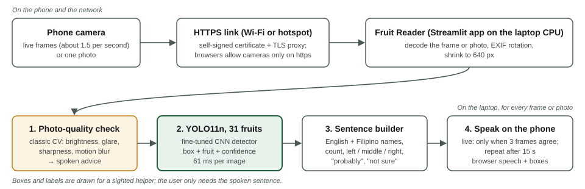
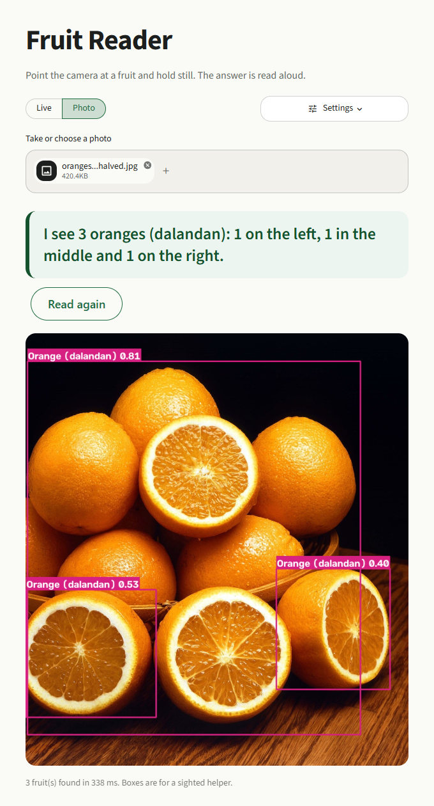
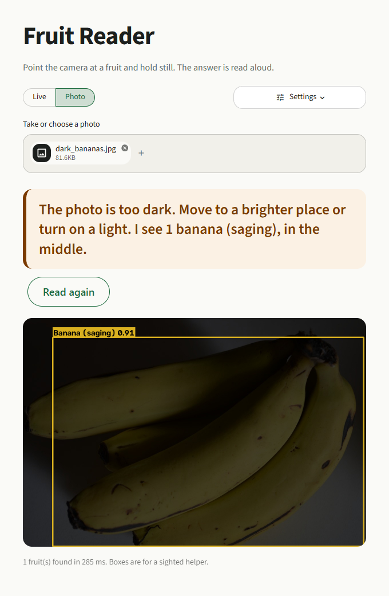
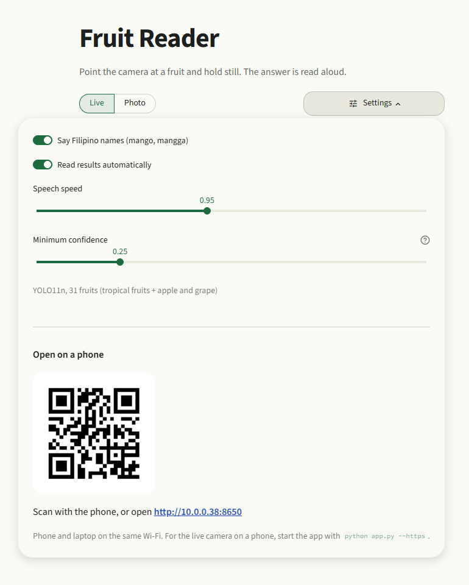
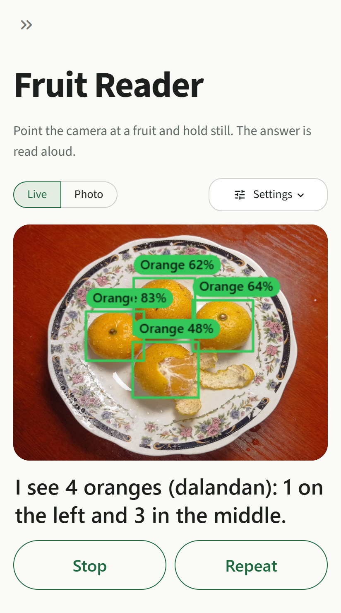
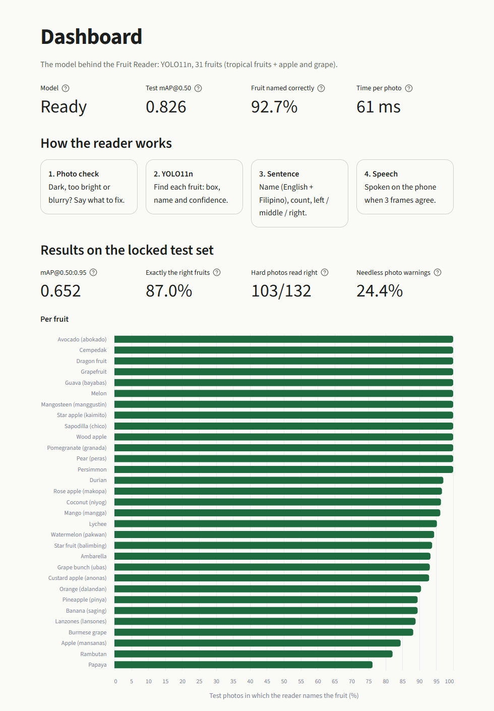

# BOTOTOY 2.0 Fruit Reader: An Assistive Fruit Identifier for Blind and Low-Vision Filipinos

**Final Project Report, Version 2 (major revision)** · CSST 106 – Perception and Computer Vision · BSCS 4A ·
Instructor: Mr. Jeremy Reyes

**Team Bototoy 2.0:** Kyle Angelo D. Mercado · Ian Patrick Z. Mesias · James Paul L. Panal

Version 2.0 · November 2026 · Branch `v2-assistive` of
[github.com/imPickleRiick/BOTOTOY-2.0-Fruit-Detection-and-Identification-Using-YOLO](https://github.com/imPickleRiick/BOTOTOY-2.0-Fruit-Detection-and-Identification-Using-YOLO/tree/v2-assistive)

---

## Abstract

Version 1 of BOTOTOY 2.0 drew boxes around six kinds of fruit in photos. After review, our instructor pointed
out that it did not solve a real-world problem. Version 2 turns the detector into a tool for a real user: a
**Fruit Reader for blind and low-vision people**. The user points a phone at fruit, and the phone **says what
it is**, in English with the Filipino name, how many there are and where they are. Example: "I see 3 mangoes
(mangga): 2 on the left and 1 in the middle."

The system recognizes **31 fruits common in the Philippines**, including mango, banana, orange (dalandan),
lanzones, rambutan, mangosteen, star apple (kaimito), sapodilla (chico), rose apple (makopa), coconut,
papaya, apple and grape. It has four parts:
1. A **photo-quality check** written with classic computer vision. A blind user cannot see that a photo is dark
   or blurred, so the reader tells them, for example "The photo is too dark. Move to a brighter place."
2. A **YOLO11n detector**, retrained on 17,123 images from two public datasets.
3. A **sentence builder** that turns detections into one short spoken sentence, with "probably" or "I am not
   sure" when the model is uncertain.
4. A **live reader** in the phone's web browser. The user does not need to take a photo: it speaks as soon as
   the same fruit has been seen in three frames in a row. No app installation is needed.

On a locked test set of 1,432 images, the detector reaches **mAP@0.50 = 0.826** and **mAP@0.50:0.95 = 0.652**
at **61 ms per image** on a laptop CPU. Measured the way a blind user experiences it, the reader names at least
one fruit in the photo correctly in **92.7%** of test photos, and names exactly the right set of fruits in
**87.0%**. On 132 hard-condition photos (dark, blurred, rotated, compressed and more), it names the right fruit
in 103, against 100 for version 1. Its quality check warns about every dark and every blurred photo in that
set. It also warns about 24% of ordinary dataset photos, mostly white-background product shots and smooth
close-ups, which is its main weakness.

The reader has been tested end to end on a team member's phone. It has **not yet been tested with blind or
low-vision users**; that is the most important next step.

---

## 1. The problem

### 1.1 Who has the problem

The Department of Health estimated in 2017 that about **332,000 Filipinos are blind in both eyes** and about
**2.18 million have low vision in both eyes** [1]. For these people, an everyday task is hard: telling which
fruit is in front of them. At home, at a sari-sari store or at a palengke stall, fruits are often sold loose,
without labels, and many have a similar size and feel (mango vs. papaya, rambutan vs. lychee, kaimito vs.
mangosteen). Today a blind person must ask someone or rely on smell and touch, which does not work for every
fruit or through a plastic bag.

### 1.2 What version 1 did and why it was not enough

Version 1 detected and counted six fruits (apple, banana, grape, orange, pineapple, watermelon) in uploaded
photos and showed boxes on a screen. It was technically complete (Phase 1–5 deliverables, v1.0 tag), but:
- **its output was visual**, so the people who most need help identifying fruit could not use it;
- **its six classes are mostly imported fruits**, while most fruits in Philippine markets were missing;
- it had **no clear user**: "detect fruit in a photo" is a demonstration, not a solution.

### 1.3 Options we considered

| Option | Pros | Why we did (not) choose it |
|---|---|---|
| Banana ripeness advisor (the instructor's suggestion): banana type → ripeness → what to do with it (e.g. overripe → banana bread) | Clear use; one fruit | We found no public dataset with banana-variety **and** ripeness labels. Labeling our own would not fit the 3-day window, and a model trained without such labels would only guess. |
| **Assistive fruit reader** (chosen) | Clear user with a real need; reuses the tested v1 pipeline; data with local fruits exists | Fits the deadline; every part can be tested |
| Fruit counting for sellers | Uses counts | v1's error review showed counts in piles are unreliable |

The reader keeps the strongest parts of version 1 (leakage-free data handling, YOLO11n training and
evaluation, the inference engine, the classic-CV knowledge from the baseline) and adds the parts a blind user
needs.

## 2. Requirements and what was delivered

The proposal's targets were written for version 1. For the revision we set requirements based on what a blind
user needs, and we report the v1 accuracy targets for reference.

| Requirement | How it is met | Status |
|---|---|---|
| The result can be used **without seeing the screen** | One spoken sentence (browser speech), read automatically; replay button; result also in a screen-reader live region | ✅ |
| Works with a **phone**, no app to install | Phone browser opens the reader from a QR code; HTTPS so the browser allows the camera | ✅ tested on a team phone |
| **No need to aim and press a button** | Live reader speaks when the same fruit is seen in 3 frames in a row | ✅ speaks 2–3 s after pointing |
| Covers **fruits common in the Philippines** | 31 classes; 19 also said in Filipino (e.g. mangga, lansones, kaimito, chico, makopa) | ✅ |
| Says **how sure** it is | "I see" / "I probably see" / "…, but I am not sure" from the confidence | ✅ |
| Tells the user when the **photo is bad** | Quality check: dark, too bright, blurry, motion blur, with advice | ✅ with false alarms (Section 6.4) |
| Names the right fruit | 92.7% of test photos at least one fruit right; 87.0% exactly right | ✅ measured |
| Fast enough for live use | 61 ms per image (laptop CPU), about 1.5 frames per second over Wi-Fi | ✅ |
| v1 target: mAP@0.50 ≥ 0.80 | 0.826 on the new test set | ✅ (different test set from v1) |
| v1 target: mAP@0.50:0.95 ≥ 0.50 | 0.652 | ✅ |
| v1 target: recall ≥ 0.70 for every class | 23 of 31 classes; lowest apple 0.28, grape 0.29 | ❌ (Section 7) |
| Tested with blind or low-vision users | Not done yet | ❌ (Section 9) |

## 3. What changed from version 1

| | Version 1 | Version 2 |
|---|---|---|
| User | none specific | blind and low-vision people |
| Output | boxes on a screen | spoken sentence (+ boxes for a sighted helper) |
| Fruits | 6 | 31 common in the Philippines |
| Names | English | English + Filipino |
| Input | uploaded photos | live phone camera, phone photo or upload |
| Photo quality | ignored | checked and explained to the user |
| Training data | 8,479 images, one dataset | 17,123 images, two datasets merged |
| Test-set mAP@0.50 | 0.490 (682 images) | 0.826 (1,432 images) |

The app opens on the Fruit Reader. The Dashboard and About pages describe the 31-fruit model (Appendix A.5). The
v1 pages (Fruit Detection, Batch Detection, YOLO11n Model, OpenCV Baseline, Model Evaluation) are kept under a
"Version 1 (6 fruits)" menu section, each marked at the top as the original 6-fruit detector, for comparison.

## 4. Data

### 4.1 Sources

| Dataset | Images | Classes | License | Used for |
|---|---|---|---|---|
| "Fruit" by trucly, Roboflow Universe, version 1 [2] | 9,041 | 30 tropical and common fruits | CC BY 4.0 | local fruits |
| Fruit Detection (v1 dataset), GitHub mirror of the Kaggle set [3] | 8,479 | 6 | CC0-1.0 | apple and grape, plus more banana, orange, pineapple and watermelon photos |

The Roboflow dataset has no apple or grape class. When we tried the 30-fruit model on real apples, it called
them star apples or guavas. That is why we merged in the version 1 dataset.

### 4.2 Preparing the 30-fruit dataset without leakage

Roboflow exports contain augmented copies, and the same source photo can appear in several splits. We applied
the same checks as in version 1 (`src/data/prepare_fruit30.py`):
- **Same source photo:** the Roboflow file name keeps the original photo name. 148 validation/test images whose
  source photo was also in another split were removed.
- **Near-duplicates:** 64-bit difference hash (dHash), Hamming distance ≤ 4. 245 more images that were near
  copies of images in another split were removed.
- In total **393 images were removed** (238 validation, 155 test); none from training.

### 4.3 Merging the two datasets (31 classes)

`src/data/prepare_fruit31.py` combines both prepared datasets:
- Class names were unified: Apple → apple, Banana → banana, and so on. **Tangerines were merged into orange**,
  because the two look alike and a blind user needs "orange (dalandan)", not the difference between two citrus
  types.
- Each dataset keeps its own leakage-free split, so no image moves between train, validation and test.
- A cross-dataset dHash check found 8 near-duplicate pairs across splits; 1 test image was removed.
- 256 boxes that extended past the image border were clipped or dropped.

| Split | Images | from v1 dataset | from Roboflow dataset | Boxes |
|---|---|---|---|---|
| train | 13,437 | 7,108 | 6,329 | 66,855 |
| val | 2,254 | 686 | 1,568 | 11,515 |
| test | 1,432 | 681 | 751 | 6,858 |
| **total** | **17,123** | | | **85,228** |

The file lists of every split are committed in `data/splits_fruit31/`. The class balance is uneven: orange has
18,402 training boxes, pomegranate 488. The full per-class numbers are in Appendix B.

### 4.4 Spoken names

`src/assist/fruit_names.py` gives every class an English singular and plural and, for 19 of the 31 fruits, the
common Filipino name: mansanas, saging, ubas, dalandan, pinya, pakwan, abokado, balimbing, niyog, anonas,
bayabas, lansones, mangga, manggustin, peras, granada, makopa, chico and kaimito. Fruits without a common
Filipino name (e.g. durian, rambutan, lychee) are said in English only.

## 5. System design



### 5.1 Step 1: photo-quality check (classic computer vision)

The v1 hard-case test showed that motion blur alone dropped detection to 4 of 12 photos. A sighted user would
see the blur and take another photo; a blind user cannot. Before detecting, the reader measures four things on
a 640-pixel copy of the photo (`src/assist/quality.py`):

| Measure | How | Problem if |
|---|---|---|
| Brightness | mean gray level (0–255) | < 60 → "too dark"; > 190 → "too bright" |
| Glare | share of pure-white pixels (≥ 250) | > 20% → "too bright" |
| Sharpness | variance of the Laplacian (second derivative); edges give high values | < 60 → "blurry" |
| Motion blur | second-derivative energy in 4 directions (0°, 45°, 90°, 135°); shaking smears detail in one direction, so the weakest/strongest ratio drops | ratio < 0.15 → "blurry from movement" |

Each problem has one spoken sentence of advice (e.g. "Hold the phone still and try again"). **A warning never
blocks the result.** The reader still names the fruit it sees after the advice, because a dark photo can still
be readable (Appendix A.2). The thresholds were chosen by measuring the 12 unseen v1 photos, 8 demo photos and their
simulated hard versions; no test-set image was used.

### 5.2 Step 2: YOLO11n detector, 31 fruits

Same method as version 1 (one-stage CNN detector, transfer learning from COCO), retrained on the merged dataset.

| Setting | Value |
|---|---|
| Model | YOLO11n (2.6 M parameters), COCO-pretrained, all layers fine-tuned, 31-class head |
| Image size / batch / epochs | 640 / 16 / 50 planned, early-stopping patience 10 |
| Optimizer | SGD, lr0 0.01, momentum 0.937, seed 42, deterministic |
| Hardware | Google Colab, Tesla T4 GPU (free tier); 125 minutes of training |
| Software | Ultralytics 8.4.215 |
| Checkpoint | best validation fitness: **epoch 44** (val mAP@0.50 0.831, mAP@0.50:0.95 0.649) |
| Inference | confidence ≥ 0.25, NMS IoU 0.7, CPU |

**Training stopped early.** The free Colab GPU quota ran out during epoch 45 of 50. Every epoch's best
checkpoint is saved to Google Drive as training goes, so we used `best.pt` from epoch 44. Validation mAP@0.50 had stayed between
0.82 and 0.83 since epoch 37, so the missing epochs would have changed little. Because the notebook's last step
never ran, the Colab environment details and the checksum recorded on Colab are missing from the training
report; the installed file's own SHA-256 is recorded instead ([training report](../outputs/yolo_fruit31/training/TRAINING_REPORT.md)).

We first trained a 30-class model on the Roboflow data alone (test mAP@0.50 0.893 on its own 751 test images).
It worked well on tropical fruits but had no apple or grape, so it was replaced by the 31-class model.

### 5.3 Step 3: sentence builder

`src/assist/describe.py` turns the detections into one sentence per fruit type, most confident type first, so
the most reliable information is heard first:

| Rule | Example |
|---|---|
| Name + count | "I see 2 bananas (saging)" |
| Position: the third of the photo that holds each box's center | "…: 1 on the left and 1 in the middle" |
| More than 5 of one fruit: say "many" (v1's error review showed counts in piles are unreliable) | "I see many oranges (dalandan), across the photo." |
| Highest confidence of that fruit ≥ 0.6: plain sentence | "I see 1 mango (mangga), in the middle." |
| 0.4–0.6 | "I probably see 1 guava (bayabas), on the left." |
| < 0.4 | "…, but I am not sure." |
| At most 4 fruit types | keeps the sentence short |
| Nothing found | "I don't see any fruit that I know." |

### 5.4 Step 4: speaking, and the live reader

**Speech.** The sentence is spoken by the phone's own browser speech engine (Web Speech API), so no audio is
sent over the network. It plays automatically, there are large "Read again" (photo) and "Repeat" (live) buttons,
and the text is also placed in an ARIA live region so screen readers (TalkBack, VoiceOver) announce it. Speech speed can be changed.

**Live reader** (`src/app/components/live_camera/`, `src/assist/live.py`). The phone sends one camera frame at a
time, waiting for the previous answer, so a slow network never builds up a queue (about 1.5 frames per second
over Wi-Fi). Speaking every frame would be unbearable, so an announcer decides when to speak:
- speak when the **same set of fruit types** has been seen in **3 frames in a row** (the user is pointing at it);
- do not repeat the same answer for **15 seconds** while the user keeps pointing at it;
- after **3 frames with no fruit**, reset, so pointing at the same fruit again is announced again;
- when no fruit is found and a photo problem lasts 3 frames, say the problem (at most every 10 seconds).

In a browser test with a simulated phone camera, the first sentence was spoken 2.6 seconds after Start.

### 5.5 Getting the phone camera into the app

The laptop runs the app; the phone opens it in its browser by scanning a QR code shown under **Settings**
(Appendix A.3). Browsers allow camera access only on secure (`https`) pages, and Streamlit's own
HTTPS mode failed on Windows, so we added:
- `src/assist/https_cert.py`: creates a self-signed certificate for the laptop's network address (OpenSSL);
- `src/assist/https_proxy.py`: a small TLS proxy that forwards `https://<laptop>:9443` to the app.

`python app.py --https` starts both. The phone shows a one-time "not private" warning because the certificate
is self-signed. On some routers, devices on the same Wi-Fi cannot reach each other ("AP isolation"); connecting
the laptop to the phone's **hotspot** solves this, and is what we use for demonstrations.

### 5.6 A minimal screen

The reader page is deliberately simple, so it is easy to use with a screen reader or with low vision, and quick
for a sighted helper to set up:
- one screen: the title, one line of instructions, a **Live / Photo** switch and one **Settings** button;
- Settings holds the speech options (Filipino names, automatic reading, speed), the minimum confidence and the
  QR code for a phone;
- live view: the camera with thin boxes in one color, the current sentence in large text, and two large buttons
  (Stop, Repeat);
- photo view: the spoken sentence in a card, a Read again button and the photo with its boxes;
- a light theme with one green accent; the sidebar with the v1 settings is hidden on this page.

The accessibility features stay: large touch targets, automatic speech and screen-reader announcements.

## 6. Evaluation

| Experiment | Data | Section |
|---|---|---|
| Box detection (mAP, precision, recall) | locked test split, 1,432 images | 6.1 |
| What the reader says (per photo) | same 1,432 images; v1 model on the same 681 v1 photos | 6.2 |
| Hard conditions + quality warnings | 12 unseen photos × 11 conditions = 132 cases | 6.3 |
| Quality-check false alarms | 1,432 test images | 6.4 |
| Unseen photos, full sentences | 12 Wikimedia Commons photos | 6.5 |
| Speed, live latency, system | laptop CPU; Chrome; team phone | 6.6 |

The test split was run once, after the model and all settings were frozen (`--final`).

### 6.1 Box detection on the locked test set

| Model | Test set | Classes | mAP@0.50 | mAP@0.50:0.95 | Time per image |
|---|---|---|---|---|---|
| v1 YOLO11n | v1 test, 682 images | 6 | 0.490 | 0.338 | 69 ms |
| 30-fruit YOLO11n | Roboflow test, 751 images | 30 | 0.893 | 0.715 | 67 ms |
| **31-fruit YOLO11n (final)** | **merged test, 1,432 images** | **31** | **0.826** | **0.652** | **61 ms** |

The three test sets differ, so these numbers are not a direct comparison. The final model's overall precision
is 0.799 and recall 0.782 (Ultralytics, at the F1-optimal confidence).

- **Strongest:** persimmon, pear, mangosteen, sapodilla, mango, cempedak and melon, all AP@0.50 ≥ 0.95.
- **Weakest:** grape 0.40, apple 0.43, Burmese grape 0.52 and banana 0.58. Apple, grape, banana and orange get
  most of their test boxes from the v1 dataset, whose crowded scenes are labeled inconsistently (one box per
  fruit in some images, one per group in others; see the v1 error review). Box recall for apple (0.28) and grape
  (0.29) is therefore low, although, as 6.2 shows, the reader names these fruits in most photos.

Per-class results are in Appendix B ([full evaluation](../outputs/yolo_fruit31/eval_test/EVALUATION.md)).

### 6.2 What the reader says

A blind user does not see boxes; they hear fruit names. So we also scored, for every test photo, the **set of
fruit names** the reader says against the set of labeled fruits (`src/evaluation/reader_test.py`):

| Measure (1,432 test photos) | Result |
|---|---|
| At least one fruit named correctly | **92.7%** |
| Exactly the right set of fruit names, nothing missing or extra | **87.0%** |
| Said nothing although fruit was present | 3.1% |

Per fruit (Appendix B), the reader names the fruit in **76% (papaya) to 100%** of the photos that contain it.
When it says a fruit, the fruit is really there in **46% (avocado) to 100%** of cases. The low values are mostly
on fruits with few test photos (avocado 6, guava 12, pomegranate 10), so they are uncertain.

**Is the 31-fruit model worse than v1 on the v1 fruits?** No. On the same 681 v1 test photos:

| Fruit | v1 model: named | 31-fruit: named | v1 model: right when said | 31-fruit: right when said |
|---|---|---|---|---|
| apple | 85.8% | 84.5% | 88.8% | 88.7% |
| banana | 84.1% | 87.3% | 84.8% | 89.4% |
| grape | 93.1% | 93.1% | 90.0% | 94.4% |
| orange | 87.3% | 87.3% | 90.5% | 93.2% |
| pineapple | 86.4% | 83.1% | 85.0% | 84.5% |
| watermelon | 90.7% | 90.7% | 90.7% | 90.7% |

It learned 25 more fruits while keeping the same accuracy on the original six, and it is more often right when
it names one, even though it now has many more fruits to confuse them with.

### 6.3 Hard conditions

The 12 unseen photos from version 1 were modified to simulate hard conditions. A case passes if the reader
names the expected fruit. "Warned" means the quality check told the user what was wrong.

| Condition | v1 model | 31-fruit reader | Warned |
|---|---|---|---|
| Original photo | 11/12 | 10/12 | 0/12 |
| Dark (brightness × 0.35) | 10/12 | 11/12 | 12/12 |
| Overexposed (× 1.8) | 12/12 | 11/12 | 4/12 |
| Out of focus (Gaussian blur 25 × 25) | 10/12 | 11/12 | 12/12 |
| Motion blur (31 px) | 4/12 | **9/12** | 12/12 |
| Rotated 30° | 11/12 | 9/12 | (12/12, false alarms) |
| Rotated 90° | 12/12 | 10/12 | 0/12 |
| Occlusion (16% of the image) | 9/12 | 10/12 | 0/12 |
| Low resolution (128 px) | 9/12 | 8/12 | 12/12 |
| JPEG quality 5 | 4/12 | **7/12** | 0/12 |
| Grayscale | 8/12 | 7/12 | 0/12 |
| **Total** | 100/132 | **103/132** | |

- The 31-fruit model handles **motion blur and heavy compression much better** (9 vs 4 and 7 vs 4), the two
  weak spots of version 1. The larger and more varied training set is the likely reason.
- It is slightly worse on rotated and grayscale photos. With 31 fruits, a misleading color or shape has more
  look-alikes to match: in grayscale, 6 of 12 answers included a wrong extra fruit.
- The quality check warned on **every dark, blurred, motion-blurred and low-resolution** photo. These photos
  were also used to choose the thresholds, so this shows the check works as designed, not how it does on new
  photos; Section 6.4 gives the independent measurement.
- The "too bright" warnings on the 30° photos are false alarms: the rotation adds white corners.
- It does not detect compression damage, occlusion or missing color, which are not problems a user can fix by
  moving.

([Reader test log](../outputs/reports/reader_test/READER_TEST.md).)

### 6.4 Quality-check false alarms

On the 1,432 test photos, which were not used to set the thresholds, the reader warned about **350 (24.4%)**:
"too bright" 180, "blurry" 124, "blurry from movement" 30, "too dark" 16. We looked at 24 random
flagged photos of each kind:
- **"Too bright":** almost all are product photos on a pure-white background. The white background, not the
  fruit, pushes the share of white pixels over 20%.
- **"Blurry":** mostly close-ups of smooth fruit (oranges, mangoes, grapes) or photos with a soft, out-of-focus
  background. Many look sharp enough to a person. The Laplacian measures how many sharp edges the whole photo
  has, and smooth fruit skin has few.

White-background product photos are common in internet datasets and rarer in phone-camera frames, but the rate
is clearly too high: the user hears needless advice in about one photo in four. Because the fruit is
still named after the advice, a false alarm costs a few seconds, not a wrong answer. Tuning the thresholds on
real phone photos is the first item of future work.

### 6.5 Unseen photos: what the reader actually said

| Photo | Spoken sentence | Correct? |
|---|---|---|
| apples_supermarket_display | I see 1 apple (mansanas), in the middle. | ✅ |
| three_bananas | I see 1 banana (saging), in the middle. | ✅ (one bunch) |
| bananas_market_stall | I see 1 banana (saging), in the middle. | ✅ (count low) |
| grape_bunch_mixed_colors | I see 1 grape bunch (ubas), in the middle. | ✅ |
| green_grapes_on_vine | I see 3 grape bunches (ubas): 1 on the left and 2 on the right. | ✅ |
| oranges_whole_and_halved | I see 3 oranges (dalandan): 1 on the left, 1 in the middle and 1 on the right. | ✅ |
| mandarins_on_plate | I see 4 oranges (dalandan): 1 on the left and 3 in the middle. | ✅ |
| oranges_on_tree | I see many oranges (dalandan), across the photo. | ✅ |
| single_pineapple | I see 2 pineapples (pinya), in the middle. | ✅ (count high) |
| apples_in_basket | I see many star apples (kaimito), across the photo. I see 1 apple (mansanas), in the middle. | partly |
| green_unripe_orange | I see 1 papaya, in the middle. | ❌ |
| yellow_watermelon_halves | I probably see 1 guava (bayabas), on the left. | ❌ (but says "probably") |

The two mistakes are fruits with an **unusual color**: a green orange and a yellow-fleshed watermelon. The model
relies strongly on color, and almost all training oranges are orange and almost all watermelons red.

### 6.6 Speed and system tests

| Measure | Result |
|---|---|
| Detection, end to end per image (laptop CPU, AMD Ryzen 5 5600U) | mean **61 ms**, 95th percentile 85 ms |
| Quality check | mean 16 ms per image (on a 640-px copy) |
| Live reader frame rate (phone → laptop over Wi-Fi, HTTPS) | about 1.5 frames per second |
| Time from Start to first spoken sentence (Chrome, simulated phone camera) | 2.6 s |
| Automated tests (`python -m pytest`) | **101 passed** (sentences, names for all 3 models, quality check, QR code, HTTPS proxy, live announcer, app pages) |
| Real phone | live reader confirmed working by the team on a phone over the phone's hotspot |

## 7. Error analysis

From Sections 6.1–6.5, the errors that matter for the user fall into five groups:

1. **Unusual colors** (green orange → papaya, yellow watermelon → guava, grayscale photos). The model leans on
   color; training photos show mostly typical, ripe colors.
2. **Look-alike fruits with few examples.** Avocado, guava and pomegranate are named in almost every photo that
   has them, but are also said when they are not there (right only 46–67% of the time). They have the fewest
   training boxes (488–607).
3. **Piles of fruit.** A basket of apples was read as "many star apples" plus one apple. Inside piles, the v1
   dataset's group labels taught the model to box groups inconsistently, which also explains the low box recall
   for apple and grape.
4. **Counts.** "1 banana" for a bunch and "2 pineapples" for one pineapple. Counting stays unreliable; this is
   why the reader says "many" for more than five.
5. **Needless quality warnings** on white-background photos and smooth close-ups (24%).

On the positive side, wrong answers are often marked as uncertain ("probably", "not sure"), so the user knows
when to double-check by touch or smell.

## 8. Limitations

- **No testing with blind or low-vision users yet.** All tests are with sighted team members and automated
  tests. Wording, speed of speech and the live-reader timing may need changes for real users.
- **It needs a laptop.** The model runs on the laptop; the phone is camera, speaker and screen. Phone and
  laptop must be on the same network (Wi-Fi or hotspot).
- **31 fruits only.** Calamansi, atis, santol, duhat, jackfruit (langka), chico variants and many others are not
  in the datasets. Unknown fruits may be named as the closest known fruit, sometimes confidently.
- **Not a ripeness, freshness or safety checker.** It does not say whether a fruit is spoiled or safe to eat.
- **Filipino names are spoken by an English voice** (`en-US`), so they may sound unnatural; 12 fruits have no
  Filipino name in our list.
- The quality check warns too often on bright and low-resolution photos (Section 6.4).
- Training stopped at epoch 44 of 50 (Colab quota), and box recall is below 0.70 for 8 of 31 classes.
- Self-signed HTTPS shows a browser warning the first time; a blind user would need help with that one-time step.

## 9. Future work

1. **User testing** with blind and low-vision people, for example through a local association or school for the
   blind: is the sentence clear, is the speech speed right, is 3 frames too slow or too fast?
2. **Tune the quality check on real phone photos** taken by the team at home and at markets, to cut the 24%
   false-alarm rate.
3. **Run on the phone itself** (export YOLO11n to TFLite/ONNX) so no laptop or network is needed.
4. **More local fruits** (calamansi, atis, santol, langka) and more photos with unusual colors (green citrus,
   yellow watermelon) and piles.
5. **Ripeness for selected fruits**, as our instructor suggested: e.g. "ripe banana" or "unripe mango", once a
   labeled dataset is collected.
6. A Filipino (Tagalog) voice when the phone has one installed; vibration feedback when a fruit is found.

## 10. Conclusion

Version 2 turns BOTOTOY 2.0 from a fruit detector into an **assistive Fruit Reader** for blind and low-vision
Filipinos. A user points a phone at fruit and hears, within a few seconds, which fruit it is, in English and
Filipino, how many there are and where, and how sure the system is. If the photo is too dark or blurred, the
reader says so and tells the user what to do.

The system combines both kinds of computer vision taught in the course:
- **classic computer vision** for the photo-quality check (Laplacian sharpness, directional second derivatives
  for motion blur, brightness and glare), and
- **deep learning** for recognition: YOLO11n fine-tuned on 17,123 leakage-free images of 31 fruits, reaching
  mAP@0.50 = 0.826 and naming the right fruit in 92.7% of test photos at 61 ms per image.

It improves on version 1 where it matters for the user: 31 local fruits instead of 6, the same accuracy on the
original fruits, much better results on motion-blurred and compressed photos, and output that does not require
sight. Its main open issues are honest ones: frequent quality warnings on bright photos, mistakes on unusually
colored fruit, and the lack of testing with real blind users, which is the next step.

## 11. Contribution table

| Member | Version 2 work |
|---|---|
| James Paul L. Panal | Data: 30-fruit dataset export and leakage removal, merging the two datasets into 31 classes, split checks (`src/data/`) |
| Kyle Angelo D. Mercado | Classic computer vision: photo-quality check and its thresholds (`src/assist/quality.py`), building on his v1 OpenCV baseline |
| Ian Patrick Z. Mesias | Colab training of both models, evaluation and reader test; Fruit Reader page, sentence builder, Filipino names, live reader, phone/HTTPS support (`src/assist/`, `src/app/`, `src/evaluation/`) |

All three members: choosing the revision topic, testing the reader on a phone, the demonstration and this report.

## 12. Reproducibility

```bash
python -m pip install -r requirements.txt       # pinned versions, CPU PyTorch
python app.py --https                           # the Fruit Reader; scan the QR code with the phone

# data (both datasets are public; the Roboflow ZIP is downloaded by hand, see docs/TRAINING_V2.md)
python -m src.data.download_dataset             # v1 dataset
python -m src.data.prepare_fruit31 --from-manifest   # rebuilds the committed 31-fruit split

# training: notebooks/train_fruit31_colab.ipynb on a Colab T4 GPU (docs/TRAINING_V2.md)
python -m src.yolo.training_report <results.zip or run folder> --config config/config_fruit31.yaml --out outputs/yolo_fruit31/training
python -m src.yolo.evaluate --split test --final --config config/config_fruit31.yaml --out outputs/yolo_fruit31/eval_test
python -m src.evaluation.reader_test            # naming, hard conditions, quality false alarms
python -m src.assist.reader photo.jpg           # the reader from the command line
python -m pytest                                # 101 tests
```

The trained weights (`models/trained/bototoy_fruit31_yolo11n.pt`, 5.5 MB) and every report are committed.

## 13. References

1. "Over 2 million Pinoys blind, sight-impaired," The Philippine Star, 7 Aug 2017 (Department of Health
   figures). https://www.philstar.com/headlines/2017/08/07/1726085/over-2-m-pinoys-blind-sight-impaired
2. trucly, *Fruit* dataset, version 1, Roboflow Universe, CC BY 4.0. https://universe.roboflow.com/trucly/fruit-5ix6x/dataset/1
3. L. Tyagi, *Fruit Detection* dataset, Kaggle; GitHub mirror lightly-ai/dataset_fruits_detection (CC0-1.0),
   commit `e626559`. https://github.com/lightly-ai/dataset_fruits_detection
4. G. Jocher and J. Qiu, *Ultralytics YOLO11*, 2024. https://docs.ultralytics.com/models/yolo11/
5. T.-Y. Lin et al., "Microsoft COCO: Common Objects in Context," ECCV 2014.
6. J. L. Pech-Pacheco et al., "Diatom autofocusing in brightfield microscopy: a comparative study," ICPR 2000
   (variance of the Laplacian as a focus measure).
7. W3C, *Web Speech API* and *WAI-ARIA 1.2* (live regions). https://www.w3.org/TR/wai-aria-1.2/
8. N. Krawetz, "Kind of Like That" (dHash), 2013. https://www.hackerfactor.com/blog/index.php?/archives/529-Kind-of-Like-That.html
9. BOTOTOY 2.0 version 1 final report (tag `v1.0`), for the v1 dataset audit, baseline and error review.

## Appendix A: Screenshots

All screenshots are of the running app with the 31-fruit model (24 Nov 2026), using photos the model never saw
in training. Files: [`docs/screenshots/`](screenshots/).



**A.1 Fruit Reader, Photo mode.** The sentence is spoken automatically and shown in a card, with a Read again
button; the boxes are for a sighted helper.



**A.2 A dark photo.** The reader first says what is wrong, then still names the banana.



**A.3 The Settings button.** Speech options, minimum confidence and the QR code to open the reader on a phone.



**A.4 Live mode on a phone screen.** Thin boxes follow the camera view; the sentence it spoke is shown in large
text above the Stop and Repeat buttons. (Chrome's phone simulation with a fake camera showing the mandarins
photo.)



**A.5 Dashboard.** Model status and the main results, how the reader works, and the share of test photos in
which the reader names each fruit.

## Appendix B: Per-fruit results (31-fruit model, locked test set)

*AP50* and *recall* are box measures (Ultralytics). *Named* = share of test photos containing the fruit in
which the reader says its name; *right when said* = share of the times the reader says the name in which the
fruit is really in the photo.

| Fruit (spoken name) | Train boxes | Test boxes | AP@0.50 | Box recall | Test photos | Named | Right when said |
|---|---|---|---|---|---|---|---|
| Ambarella | 721 | 68 | 0.779 | 0.779 | 15 | 93% | 78% |
| Apple (mansanas) | 6,070 | 531 | 0.427 | 0.277 | 148 | 84% | 89% |
| Avocado (abokado) | 521 | 34 | 0.927 | 0.941 | 6 | 100% | 46% |
| Banana (saging) | 3,305 | 339 | 0.576 | 0.490 | 153 | 90% | 90% |
| Burmese grape | 1,275 | 183 | 0.520 | 0.470 | 34 | 88% | 94% |
| Cempedak | 779 | 83 | 0.956 | 0.916 | 18 | 100% | 78% |
| Coconut (niyog) | 504 | 55 | 0.726 | 0.705 | 28 | 96% | 84% |
| Custard apple (anonas) | 603 | 76 | 0.931 | 0.920 | 28 | 93% | 100% |
| Dragon fruit | 1,043 | 218 | 0.941 | 0.844 | 46 | 100% | 100% |
| Durian | 1,430 | 141 | 0.931 | 0.879 | 34 | 97% | 92% |
| Grape bunch (ubas) | 6,027 | 603 | 0.398 | 0.289 | 145 | 93% | 94% |
| Grapefruit | 794 | 91 | 0.906 | 0.912 | 23 | 100% | 96% |
| Guava (bayabas) | 607 | 60 | 0.942 | 0.917 | 12 | 100% | 60% |
| Lanzones (lansones) | 732 | 94 | 0.787 | 0.702 | 9 | 89% | 73% |
| Lychee | 1,872 | 226 | 0.668 | 0.678 | 21 | 95% | 95% |
| Mango (mangga) | 3,749 | 750 | 0.964 | 0.904 | 53 | 96% | 91% |
| Mangosteen (manggustin) | 1,041 | 80 | 0.970 | 0.925 | 16 | 100% | 89% |
| Melon | 588 | 49 | 0.952 | 0.963 | 23 | 100% | 79% |
| Orange (dalandan) | 18,402 | 1,179 | 0.672 | 0.549 | 200 | 90% | 93% |
| Papaya | 958 | 107 | 0.830 | 0.626 | 21 | 76% | 84% |
| Pear (peras) | 701 | 47 | 0.984 | 0.957 | 22 | 100% | 96% |
| Persimmon | 915 | 117 | 0.987 | 0.962 | 34 | 100% | 100% |
| Pineapple (pinya) | 3,759 | 429 | 0.826 | 0.723 | 95 | 90% | 90% |
| Pomegranate (granada) | 488 | 31 | 0.781 | 0.871 | 10 | 100% | 67% |
| Rambutan | 1,656 | 174 | 0.766 | 0.695 | 39 | 82% | 100% |
| Rose apple (makopa) | 1,587 | 295 | 0.930 | 0.881 | 30 | 97% | 91% |
| Sapodilla (chico) | 616 | 91 | 0.969 | 0.956 | 25 | 100% | 86% |
| Star apple (kaimito) | 1,667 | 266 | 0.926 | 0.863 | 20 | 100% | 87% |
| Star fruit (balimbing) | 602 | 72 | 0.940 | 0.925 | 16 | 94% | 100% |
| Watermelon (pakwan) | 3,250 | 350 | 0.829 | 0.786 | 124 | 94% | 89% |
| Wood apple | 593 | 19 | 0.877 | 0.947 | 3 | 100% | 75% |
| **All** | **66,855** | **6,858** | **0.826** | **0.782** | **1,432** | | |

## Appendix C: Evidence index

| Evidence | Location |
|---|---|
| v2 screenshots | `docs/screenshots/v2_*.png` |
| 30-fruit split (leakage removal log) | `data/splits_fruit30/` |
| 31-fruit split (file lists, merge log, class counts) | `data/splits_fruit31/` |
| Training report and curves (31 fruits) | `outputs/yolo_fruit31/training/` |
| Locked test evaluation (31 fruits) | `outputs/yolo_fruit31/eval_test/` |
| 30-fruit model training and test | `outputs/yolo_fruit30/` |
| Reader test: naming, hard conditions, quality false alarms | `outputs/reports/reader_test/` |
| Reader code: quality check, names, sentences, live announcer, phone/HTTPS | `src/assist/` |
| Live camera component | `src/app/components/live_camera/` |
| Training instructions and notebooks | `docs/TRAINING_V2.md`, `notebooks/train_fruit31_colab.ipynb` |
| Trained model | `models/trained/bototoy_fruit31_yolo11n.pt` |
| Version 1 report and evidence | `docs/FINAL_REPORT.pdf`, tag `v1.0` |
