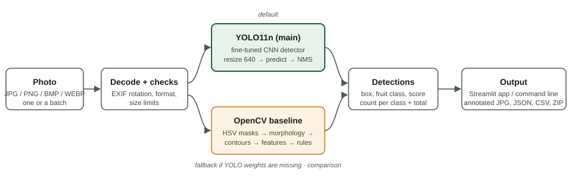
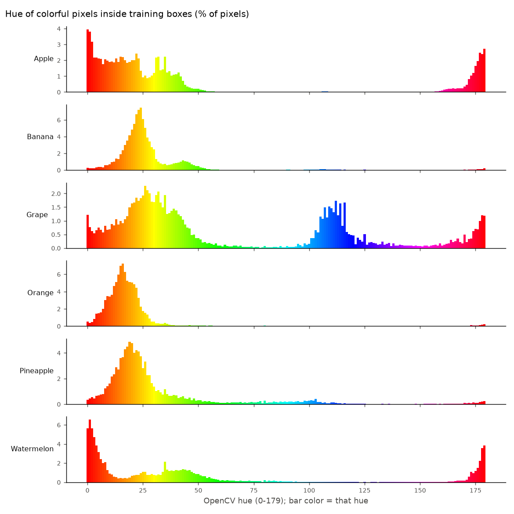
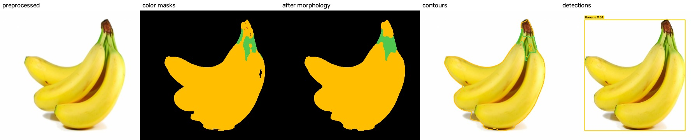
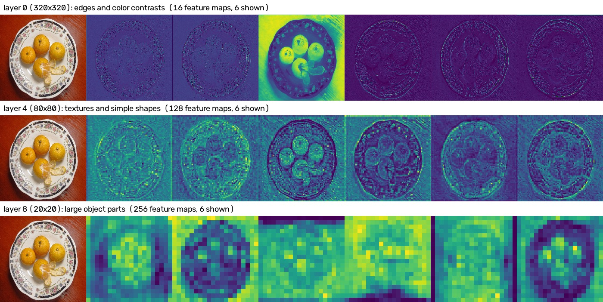
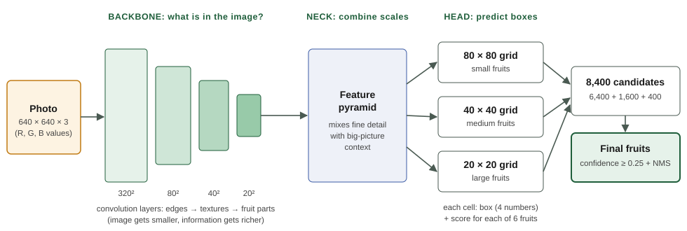
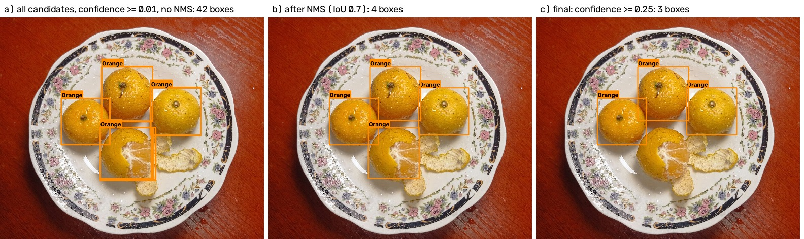
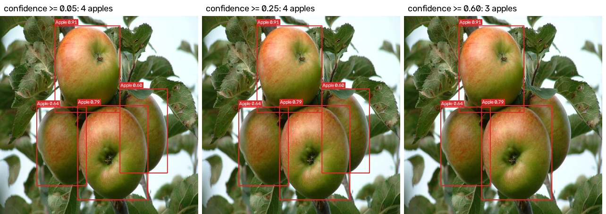
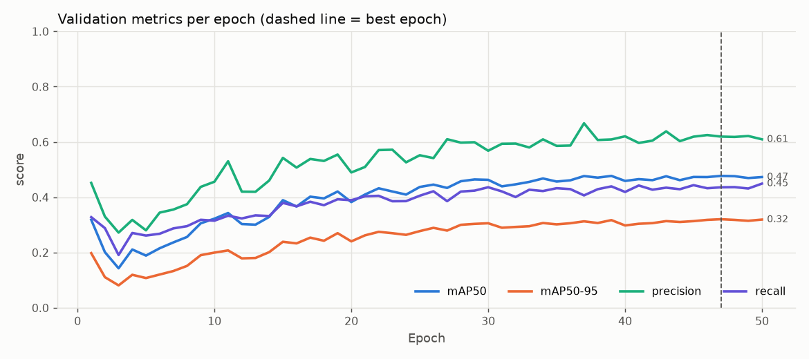
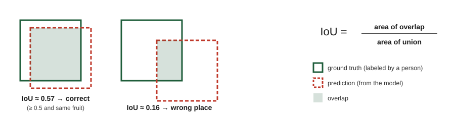

# How BOTOTOY 2.0 Works

**A plain-language guide to the system and its computer vision**

BOTOTOY 2.0: Fruit Detection and Identification Using YOLO · CSST 106 · BSCS 4A

Team: Kyle Angelo D. Mercado · Ian Patrick Z. Mesias · James Paul L. Panal

This guide explains, step by step, what happens between uploading a photo and seeing labeled boxes on the
screen. It covers both methods in the system: a traditional OpenCV pipeline and a YOLO11n neural network. Every
figure was made with the project's own code and trained model.

---

## 1. What the system does

You give BOTOTOY a photo. It finds every fruit it recognizes and returns four things:

| Output | Example |
|---|---|
| A **bounding box** around each fruit | a rectangle from pixel (297, 394) to (533, 619) |
| The **fruit type** (one of 6 classes) | Apple, Banana, Grape, Orange, Pineapple, Watermelon |
| A **confidence score** from 0 to 1 | 0.84 = the model is fairly sure |
| **Counts** per fruit type and in total | Orange: 3, total: 3 |

This task is called **object detection**: finding *where* each object is and *what* it is, for many objects in
one image. It is harder than **image classification**, which only says what one image shows as a whole.

## 2. The big picture

| Step | What happens | Code |
|---|---|---|
| 1. Input | A photo is uploaded in the app, or passed on the command line | `app.py`, `src/app/` |
| 2. Decode and check | The file becomes a grid of pixel numbers. Bad files are rejected with a message. | `src/inference/image_processor.py` |
| 3. Detect | **YOLO11n** (main method) or the **OpenCV baseline** finds the fruits | `src/yolo/`, `src/baseline/` |
| 4. Post-process | Duplicate boxes are removed; weak detections are dropped | inside both detectors |
| 5. Count and draw | Boxes are counted per class and drawn on a copy of the photo | `src/utils/detections.py` |
| 6. Output | Shown in the app; downloadable as an annotated JPG, JSON, CSV or ZIP | `src/app/`, `src/inference/batch_processor.py` |

Both detectors return results in the same format, so the rest of the system does not care which one ran. If
the YOLO model file is missing or broken, the system switches to the OpenCV baseline automatically and says so.

## 3. How a computer sees an image

To a computer, a color photo is a **grid of numbers**. A 640 × 640 photo is 640 rows × 640 columns of pixels.
Each pixel has 3 numbers between 0 and 255: blue, green and red. OpenCV stores them in **BGR** order. The whole
image is therefore an array of 640 × 640 × 3 = 1,228,800 numbers.

All computer vision is arithmetic on this array. The goal is to turn 1.2 million raw numbers into a few
meaningful ones: "an orange, at this position, 84% sure".

When a file arrives, the system first does the following (`decode_image`):
- **Decodes** the file (JPG, PNG, BMP or WEBP) into this pixel array.
- **Rotates** phone photos upright, using the orientation stored in their EXIF data.
- **Converts** grayscale and transparent images to 3-channel color.
- **Rejects** empty, corrupt or non-image files, images smaller than 32 px, and images over 50 megapixels.

---

## 4. Method A: the OpenCV baseline (traditional computer vision)

The baseline uses **hand-designed rules**: we, the programmers, decided which colors and shapes mean "fruit".
Nothing is learned from data except the color ranges, which we measured from training photos. It runs ten steps.

### Step 1: Resize and blur

The image is resized so its longer side is 640 px, which makes the processing time predictable. A **Gaussian
blur** (5 × 5) then replaces each pixel with a weighted average of its neighbors. This removes noise and fine
texture, so a fruit's surface looks like one smooth color region.

### Step 2: Convert BGR to HSV

**HSV** describes each pixel by:
- **Hue (H):** the color itself, 0–179 in OpenCV. Red ≈ 0 or 179, orange ≈ 15, yellow ≈ 30, green ≈ 60, blue ≈ 120.
- **Saturation (S):** how vivid the color is.
- **Value (V):** how bright it is.

**Why HSV?** In BGR, a shadow changes all three numbers at once. In HSV, a shadow mostly changes V, and the hue
stays about the same. This makes "find orange-colored pixels" much more reliable under different lighting.

We measured the hue of the fruit pixels inside 400 labeled boxes per class from the training set:

The chart shows both the method's strength and its weakness. Each fruit has a typical hue. But **orange
(peak ≈ 16), pineapple (≈ 22) and banana (≈ 24) overlap almost completely**, so color alone cannot tell them
apart. Dark grapes show up as blue (≈ 110).

### Step 3: Color masks (thresholding)

`cv2.inRange` keeps only the pixels whose H, S and V fall inside a range. The result is a **binary mask**: white
where the pixel has the right color, black elsewhere. We make four masks, one per color group:

| Mask | Hue range | Looks for |
|---|---|---|
| red | 0–7 and 165–179 (red wraps around) | apples, watermelon flesh |
| warm | 8–34 | oranges, bananas, pineapples |
| green | 35–85 | green apples, watermelon rind |
| purple | 95–165 | dark grapes |

This is **segmentation by thresholding**: splitting the image into "maybe fruit" and "background" by pixel value.

### Step 4: Morphology (cleaning the masks)

Raw masks are noisy, with white specks in the background and black holes inside fruits. Two **morphological
operations** fix this:
- **Opening** = erosion, then dilation (5 × 5 ellipse). Erosion shrinks white areas, so tiny specks disappear.
  Dilation then restores the size of the real regions.
- **Closing** = dilation, then erosion (9 × 9 ellipse, twice). This fills small holes and gaps inside a fruit
  (highlights, stems) without making the fruit bigger.

### Step 5: Contours

`cv2.findContours` traces the outline of each white blob in the cleaned mask. Each outline is one **candidate
region**. Regions smaller than 1% of the image are dropped: on validation, about 98% of them were false alarms.
Regions larger than 90% are dropped too, because they are background.

### Step 6: Features (describing each region with numbers)

For each region we measure:

| Feature | Formula | What it tells us |
|---|---|---|
| Mean hue | circular average of the hue values | the main color (handles red at both 0 and 179) |
| Saturation | average S | vivid (orange) or dull (pineapple skin) |
| Elongation | long side ÷ short side of the rotated rectangle | a banana is long; an orange is not |
| Extent | region area ÷ bounding-box area | a circle fills ≈ 0.785; a triangular slice ≈ 0.5 |
| Circularity | 4π × area ÷ perimeter² | 1.0 = perfect circle; lower = irregular |
| Solidity | region area ÷ convex-hull area | bumpy shapes, such as grape bunches and leaves, are lower |

### Step 7: Rules (classification)

A **decision list** picks the fruit from the color group and the features. The first matching rule wins:
- **Red region:** triangular (low extent) → Watermelon slice, otherwise → Apple.
- **Warm region:**
  - elongated (≥ 2.2) → Banana;
  - orange hue, vivid and round → Orange;
  - tall and dull → Pineapple;
  - yellow → Banana;
  - otherwise → Orange.
- **Green region:** large and round → Watermelon; round and convex → Apple; irregular → rejected (probably leaves).
- **Purple region:** → Grape.

Each detection gets a **rule score** (rule reliability × compactness × size). It is used only to rank
detections; it is **not** a real probability.

### Steps 8–10: Merge, count, draw

Boxes from different masks that overlap the same object are merged by **non-maximum suppression** (explained in
Section 5.5). The remaining boxes are scaled back to the original photo, counted per class, and drawn.

*From left: preprocessed image → color mask → after morphology → contours → final detection.*

### Strengths and limits of the baseline

| Works well | Fails |
|---|---|
| A single fruit on a plain background | Cluttered backgrounds: wood, leaves and clothing have fruit colors too |
| Fast (≈ 25–35 ms per image) | Fruits with similar colors (orange / banana / pineapple) |
| Every decision can be explained | Touching fruits merge into one region |
| No training, no GPU | Grayscale photos (no color at all) |

On the 682 test photos, it reaches only **mAP@0.50 = 0.049**, and it finds just 3% of the pineapples. This is
why the main method learns from data instead of following rules.

---

## 5. Method B: YOLO11n (deep learning)

### 5.1 The idea: learn the rules from examples

Instead of writing rules ourselves, we showed a neural network **7,108 labeled photos** with 32,059 boxes. The
network adjusted 2.6 million internal numbers (**weights**) until its predicted boxes matched the labeled boxes.
It learns, on its own, which combinations of color, texture, shape and context mean "banana". That is why it
also works on grayscale photos, where the baseline is blind.

**YOLO** stands for "You Only Look Once": the whole image goes through the network **once**, and all boxes come
out together. This makes it fast enough for a laptop CPU (≈ 66 ms per photo). **YOLO11n** is the smallest
("nano") version of Ultralytics' YOLO11.

### 5.2 Convolution: the basic operation

A **convolution** slides a small grid of weights (a **filter**, e.g. 3 × 3) over the image. At every position
it multiplies the filter with the pixels under it and adds the results up. A filter whose weights are negative on
the left and positive on the right gives large values wherever the image changes from dark to light: it is an
**edge detector**. This is the same idea as the Sobel filter from class. The difference is that the network
**learns** its filter weights from data instead of using fixed ones.

The output of one filter is a **feature map**: an image showing where that filter's pattern appears. A layer
applies many filters at once, giving many feature maps. Then an **activation function** (SiLU) keeps the
strong responses and suppresses the weak ones.

### 5.3 Inside the network: from edges to fruit parts

Layers are stacked. Each layer works on the previous layer's feature maps, so later layers detect **combinations**
of earlier patterns. Some layers use a **stride of 2**, which halves the image size: the network trades detail
for a wider view. Here are real feature maps from our trained model for one photo:

How the feature maps change with depth:
- **Layer 0 (320 × 320):** responds to edges and color contrasts. The outlines of the plate and fruits are
  visible.
- **Layer 4 (80 × 80):** responds to textures and round shapes. The fruits start to stand out as round blobs.
- **Layer 8 (20 × 20):** each "pixel" now summarizes a 32 × 32 patch of the photo. The maps respond to large
  object parts and regions, and are no longer recognizable to people.

### 5.4 The three parts of YOLO11n

| Part | Layers | Job |
|---|---|---|
| **Backbone** | 0–10: convolutions, C3k2 blocks, SPPF (pooling at several sizes), C2PSA (attention) | Turn pixels into rich feature maps: *what* is in the image |
| **Neck** | 11–22: upsampling and concatenation (a feature pyramid) | Combine fine detail from early layers with context from deep layers |
| **Head** | 23: Detect | Predict boxes and classes at 3 scales |

The head predicts on **three grids**:
- an **80 × 80** grid for small fruits;
- a **40 × 40** grid for medium fruits;
- a **20 × 20** grid for large fruits.

That gives 6,400 + 1,600 + 400 = **8,400 grid cells**. Every cell makes one prediction of 10 numbers:

- **4 numbers for the box:** the distances from the cell to the box's left, top, right and bottom edges.
  This is "anchor-free" detection.
- **6 class scores**, one per fruit, each between 0 and 1.

We checked this on our model: its raw output for one photo is a tensor of shape **(1, 10, 8400)**. A
prediction's **confidence** is its highest class score, and that class is the predicted fruit.

Before entering the network, the photo is resized to 640 px with its proportions kept (the empty area is padded
with gray), converted from BGR to RGB, and scaled from 0–255 to 0–1.

### 5.5 From 8,400 candidates to a few fruits

Most of the 8,400 predictions are background with tiny scores, and each real fruit is predicted by several
neighboring cells. Two filters fix this:

1. **Confidence threshold (0.25):** predictions with confidence below 0.25 are thrown away.
2. **Non-maximum suppression (NMS):**
   1. Sort the remaining boxes by confidence.
   2. Keep the best box.
   3. Delete every other box of the same class that overlaps it with IoU above 0.7. (IoU is explained in
      Section 6.)
   4. Repeat with the next box that is left.

What the three panels show:
- **(a)** With a 0.01 confidence threshold and no NMS, there are 42 boxes, many stacked on the same fruits.
- **(b)** After NMS, one box per fruit remains: 4 boxes.
- **(c)** The final 0.25 threshold drops the peeled mandarin, which had low confidence, leaving 3 oranges.

The **confidence threshold** is a trade-off you can change in the app's sidebar:
- **Lower** gives more boxes: more real fruits found (higher **recall**), but more false alarms.
- **Higher** gives fewer, surer boxes (higher **precision**), but more misses.

*At 0.60, the apple scored just under 0.60 disappears.*

### 5.6 How the network learned (training)

**Transfer learning.** We did not start from random weights. We started from YOLO11n pre-trained on **COCO**,
a dataset of 118,000 everyday photos in 80 classes, including apple, banana and orange. Its early layers already
detect edges, textures and shapes. Ultralytics replaced the last layer with a new one for our 6 classes, and we
then **fine-tuned** all layers on our fruit photos. After just one pass over the data (epoch 1), validation
mAP@0.50 was already 0.32.

**The training loop:**
1. Take a **batch** of 16 training photos and run them through the network.
2. Compare the predictions with the labeled boxes using a **loss function**:
   - **box loss:** how far off the box edges are, using CIoU and distribution focal loss;
   - **class loss:** how wrong the class scores are, using binary cross-entropy.
3. **Backpropagation** computes, for each of the 2.6 million weights, which direction would reduce the loss.
4. **Gradient descent** (SGD, learning rate 0.01) moves every weight a small step in that direction.
5. Repeat. One **epoch** is one pass over all 7,108 photos, which is 445 batches. We trained 50 epochs, about
   22,000 weight updates in total. This took 94 minutes on a Google Colab T4 GPU.

**Augmentation.** During training only, photos were randomly changed so the model sees more variety:
- **Mosaic:** 4 photos combined into one.
- Horizontal flips.
- Color (HSV) changes.
- Zooming in and out by up to ±50%.

**Choosing the best model.** After every epoch, the model was scored on the separate **validation** photos,
which are never used for training. The best epoch (47) was kept as `models/trained/bototoy_yolo11n.pt`. The
**test** photos were used only once, at the very end, to measure the final result honestly.

---

## 6. How we measure accuracy

**IoU (Intersection over Union)** measures how well two boxes overlap. It ranges from 0 (no overlap) to 1
(identical boxes).

A prediction counts as **correct (a true positive)** if it overlaps a labeled fruit of the **same class** with
IoU ≥ 0.5. Other predictions are **false positives**. Labeled fruits that no prediction matched are **false
negatives** (misses).

| Measure | Question it answers | YOLO11n (test) | Baseline (test) |
|---|---|---|---|
| **Precision** | Of the boxes we drew, how many were right? | 0.668 | 0.072 |
| **Recall** | Of the real fruits, how many did we find? | 0.410 | 0.075 |
| **AP** (average precision) | Area under the precision–recall curve as the confidence threshold varies, per class | 0.39–0.70 | 0.01–0.08 |
| **mAP@0.50** | Mean AP over the 6 classes, IoU ≥ 0.5 | **0.490** | 0.049 |
| **mAP@0.50:0.95** | Same, averaged over stricter IoU thresholds 0.50 to 0.95 | 0.338 | 0.031 |
| Exact count | Share of photos where the fruit count was exactly right | 45.0% | 15.8% |
| Speed (laptop CPU) | Time from file to annotated image | 69 ms | 35 ms |

## 7. Why YOLO11n beats the baseline, and where it still fails

| Situation | Baseline (rules) | YOLO11n (learned) |
|---|---|---|
| Grayscale photo of apples and bananas | finds nothing: no color | finds 2 apples and 1 banana |
| Watermelon slices | 11 boxes, mixing Watermelon with 3 wrong fruit types | 2 Watermelon boxes |
| Cluttered market or tree | colored background becomes "fruit" | uses shape and context, ignores most background |
| Orange vs pineapple vs banana | same hue, so shape rules guess | learned texture (pineapple skin, banana shape) |

YOLO11n still has limits. These were measured in our error review and in the hard-case tests:
- **Crowded piles:** it often draws one box around the whole pile. The dataset labels piles inconsistently,
  sometimes per fruit and sometimes per group. This causes half of all misses.
- **Very small fruits** (less than 1% of the photo) are often missed.
- **Motion blur and heavy JPEG compression** remove most detections.
- **Unusual colors:** a green orange is called Apple, because almost all training oranges are orange.

## 8. Glossary

| Term | Meaning |
|---|---|
| Bounding box | Rectangle around an object: (x1, y1) top-left, (x2, y2) bottom-right, in pixels |
| BGR / HSV | Two ways to store a pixel's color: blue-green-red, or hue-saturation-value |
| Thresholding | Keeping pixels whose values fall in a range, giving a black-and-white mask |
| Morphology | Shape operations on masks: erosion, dilation, opening, closing |
| Contour | The outline of a region in a mask |
| Convolution / filter | Sliding a small grid of weights over an image to detect a pattern |
| Feature map | The output of a filter: where its pattern appears |
| CNN | Convolutional neural network: many stacked convolution layers |
| Weights | The numbers inside the network that training adjusts (2.6 million in YOLO11n) |
| Transfer learning | Starting from a model trained on another dataset (COCO), then fine-tuning |
| Epoch / batch | One pass over all training photos / a group of photos processed together |
| Loss | A number measuring how wrong the predictions are; training makes it smaller |
| Confidence | The model's score (0–1) for its predicted class |
| NMS | Non-maximum suppression: removes duplicate boxes on the same object |
| IoU | Intersection over union: overlap of two boxes, 0 to 1 |
| Precision / recall | Share of detections that are right / share of real objects that are found |
| mAP | Mean average precision: the standard single-number accuracy for detectors |
| Train / validation / test | Photos for learning / for choosing settings / for the final, one-time score |
