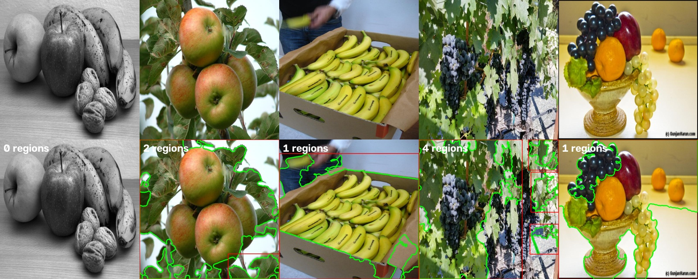
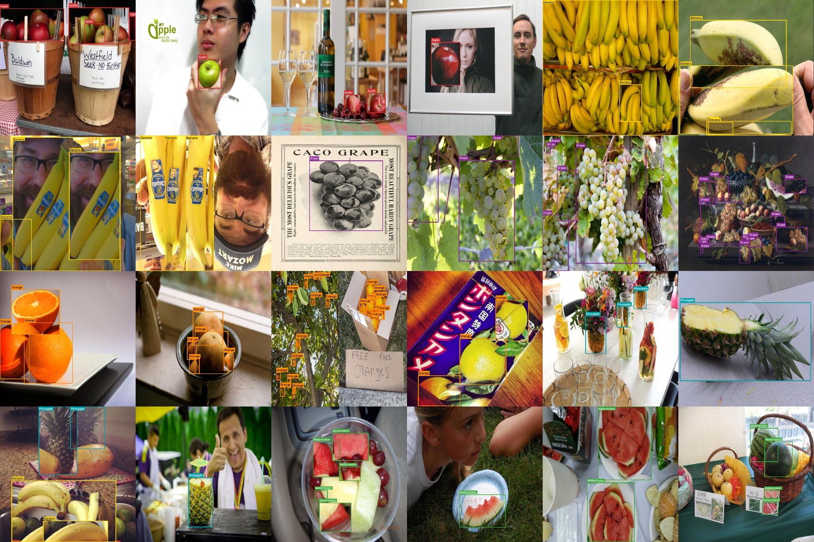

# Checkpoint 1 of 5: Proposal and plan

**BOTOTOY 2.0: Fruit Detection and Identification Using YOLO** · CSST 106 · BSCS 4A · Mr. Jeremy Reyes

Team: Kyle Angelo D. Mercado · Ian Patrick Z. Mesias · James Paul L. Panal

> This document was compiled on 20 Nov 2026 from the repository. It maps each item of the checkpoint hand-in
> list to its evidence. The Git history shows when each part was committed.

## Hand-in checklist

| # | Required | Evidence | Status |
|---|---|---|---|
| 1 | Proposal PDF (3–5 pages): title, problem, objectives, baseline + main method, data, workflow diagram, task assignments, timeline | Team proposal "Fruit Detection and Identification Using YOLO" (Word document dated 15 Oct 2026, kept outside the repository). Summary below. | ✅ (separate file) |
| 2 | Data evidence: dataset link + contact sheet of ≥ 20 labeled samples | Dataset: [lightly-ai/dataset_fruits_detection](https://github.com/lightly-ai/dataset_fruits_detection) (mirror of [Kaggle lakshaytyagi01/fruit-detection](https://www.kaggle.com/datasets/lakshaytyagi01/fruit-detection)). Contact sheet of **24** labeled samples: [`samples_grid.jpg`](../../outputs/reports/dataset/samples_grid.jpg) | ✅ |
| 3 | Feasibility spike: one script that loads 5 images and runs one operation, plus a screenshot of the output | [`src/feasibility_spike.py`](../../src/feasibility_spike.py) (HSV threshold → morphology → contours on 5 images). Output: [`spike_output.jpg`](../../outputs/reports/feasibility_spike/spike_output.jpg) | ✅ |
| 4 | GitHub repository with README stub, the spike, a commit from every member, tag `cp1-proposal` | [Repository](https://github.com/imPickleRiick/BOTOTOY-2.0-Fruit-Detection-and-Identification-Using-YOLO) with a full README | ⚠️ All commits so far are from one member; the `cp1-proposal` tag does not exist |

## Proposal summary

- **Problem:** counting and identifying fruit by eye is slow and inconsistent when photos contain many,
  overlapping fruits, or varied lighting and backgrounds.
- **Scope:** six classes (apple, banana, grape, orange, pineapple, watermelon) in still RGB images. For each
  fruit: a bounding box, label and confidence; counts per class and in total. Ripeness, quality, weight and
  video are out of scope.
- **Objectives:** on a locked test set, mAP@0.50 ≥ 0.80 and mAP@0.50:0.95 ≥ 0.50; recall ≥ 0.70 for every
  class; ≤ 1 s per 640×640 image on the team laptop.
- **Simple baseline:** OpenCV HSV color masks, morphology, contours and hand-written shape/color rules.
- **Main method:** a fine-tuned YOLO11n (Ultralytics, transfer learning from COCO).
- **Data:** 8,479 images, YOLO labels, CC0-1.0.
- **Workflow:** input → audit and split → preprocess → baseline or YOLO → post-process and output → metrics
  and demo.
- **Task assignments:**
  - Panal: data pipeline.
  - Mercado: OpenCV baseline.
  - Mesias: YOLO training and the inference interface.

## Feasibility spike result

`python -m src.feasibility_spike` loads 5 images from `assets/samples/`. On each it runs a Gaussian blur, a BGR
→ HSV conversion and a color threshold, then morphological opening and closing, then external contours (≥ 1% of
the image). It draws the contours and their bounding boxes.



Console output:

```
apples_bananas_grayscale.jpg: 640x640, 0 candidate fruit regions
apples_on_tree.jpg: 640x640, 2 candidate fruit regions
bananas_in_box.jpg: 640x640, 1 candidate fruit regions
grapes_in_vineyard.jpg: 640x640, 4 candidate fruit regions
mixed_fruit_bowl.jpg: 640x640, 1 candidate fruit regions
```

**What the spike showed:**
- Images and labels load correctly.
- Color segmentation finds fruit regions on colorful photos.
- It finds nothing on the grayscale photo, and it merges touching fruits.

These limits are why the main method is a learned detector (YOLO11n) rather than color rules.

## Contact sheet (24 labeled training samples, 4 per class)


