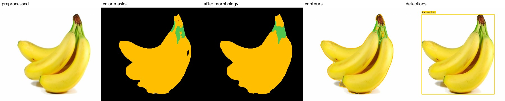

# Checkpoint 2 of 5: 50% progress check

**BOTOTOY 2.0: Fruit Detection and Identification Using YOLO** · CSST 106 · BSCS 4A

Team: Kyle Angelo D. Mercado · Ian Patrick Z. Mesias · James Paul L. Panal

> This document was compiled on 20 Nov 2026 from the repository. It maps each item of the checkpoint hand-in
> list to its evidence. The Git history shows when each part was committed.

## Hand-in checklist

| # | Required | Evidence | Status |
|---|---|---|---|
| 1 | Pinned environment + README "How to run" that works on a fresh clone | [`requirements.txt`](../../requirements.txt) (exact versions, CPU PyTorch); [README](../../README.md) Setup and Run sections | ✅ |
| 2 | Dataset acquired, organised, split; one-page data card | `src/data/` (download, validation, split); committed split lists in [`data/splits/`](../../data/splits/); data card below; full [audit report](../../outputs/reports/dataset/DATASET_AUDIT.md) | ✅ |
| 3 | Preprocessing / feature extraction as code in `src/` | [`src/baseline/preprocessing.py`](../../src/baseline/preprocessing.py), [`segmentation.py`](../../src/baseline/segmentation.py), [`feature_extraction.py`](../../src/baseline/feature_extraction.py) | ✅ |
| 4 | Core algorithm or baseline, with ONE measured validation result | OpenCV baseline, validation split (686 images): **mAP@0.50 = 0.053**, 57.7 ms per image ([baseline report](../../outputs/baseline/BASELINE_REPORT.md)) | ✅ |
| 5 | Working prototype: one command, image in → output written | `python -m src.baseline.pipeline photo.jpg --stages --out outputs/baseline/demo` | ✅ |
| 6 | ≥ 6 screenshots or sample outputs | 8 annotated outputs + 8 step-by-step panels in [`outputs/baseline/demo/`](../../outputs/baseline/demo/) | ✅ |
| 7 | Progress report (1–2 pages) | Below | ✅ |
| — | Tag `cp2-50` | — | ❌ not created |

## Data card

| | |
|---|---|
| **Source** | GitHub mirror [lightly-ai/dataset_fruits_detection](https://github.com/lightly-ai/dataset_fruits_detection), pinned commit `e626559`, of the Kaggle dataset [lakshaytyagi01/fruit-detection](https://www.kaggle.com/datasets/lakshaytyagi01/fruit-detection) by Lakshay Tyagi |
| **License** | CC0-1.0 (public domain), LICENSE file in the mirror |
| **Size** | 8,479 JPG images, 36,922 bounding boxes, 4,571 unique source photos |
| **Classes** | 0 Apple, 1 Banana, 2 Grape, 3 Orange, 4 Pineapple, 5 Watermelon |
| **Labeling** | By the dataset author, in YOLO format (`class x_center y_center width height`, normalized). Exported from Roboflow. Not relabeled by the team. |
| **Preprocessing by the author** | Auto-orientation, stretched to 640×640. The training split includes 1–3 Roboflow-augmented copies of each photo. |
| **Our checks** | 0 missing labels, 0 corrupt images, 0 invalid class IDs, 0 out-of-range boxes. 5 near-duplicate pairs crossed train/valid (dHash); the 3 validation images involved were removed. |
| **Split** | Original training split kept whole (augmented copies cannot leak). Original valid + test pooled and split 50/50 into val/test, grouped by near-duplicates, stratified by class, seed 42. 0 overlap verified. |

| Split | Images | Unique photos | Share of unique photos | Apple | Banana | Grape | Orange | Pineapple | Watermelon |
|---|---|---|---|---|---|---|---|---|---|
| train | 7,108 | 3,200 | 70.0% | 6,070 | 2,971 | 6,027 | 13,938 | 1,372 | 1,681 |
| val | 686 | 686 | 15.0% | 448 | 284 | 572 | 883 | 140 | 164 |
| test | 682 | 682 | 14.9% | 531 | 277 | 603 | 728 | 101 | 129 |

Box counts per class are shown.

**Known issues:**
- Orange has 9.6 times as many boxes as Pineapple.
- Some boxes cover a whole group of fruits.
- Some lemons are labeled Orange.
- Paintings and illustrations appear among the photos.
- Shapes are distorted by the 640×640 stretch.

## Progress report

**Completed (against the proposal's checkpoint 2 plan, "validator and final split; baseline; initial YOLO
fine-tuning; sample outputs and first metrics"):**
- Pinned environment and project structure; all settings in `config/config.yaml`.
- Dataset download (pinned commit), validator, leakage-free split and audit report with charts and a 24-sample
  contact sheet.
- Complete OpenCV baseline:
  - preprocessing, HSV color masks, morphology, contours, shape and color features, rules, NMS and counting;
  - command-line tool with step-by-step output panels;
  - validation evaluation, an ablation log and a lighting test.
- Shared metric code (`src/utils/metrics.py`), identical to the Ultralytics AP formula, so the baseline and YOLO
  can be compared directly.

**Pending:** YOLO11n training (planned for a Colab GPU), integration into one pipeline, user interface.

**Percent complete: about 50%.** The data pipeline and the baseline (the first two of four modules in the
proposal) are complete and tested. YOLO training and the interface are not started.

**Blockers:**
1. The team's laptops have no NVIDIA GPU. 50 epochs of CPU training would take more than 100 hours. Training
   was therefore moved to a Google Colab T4 GPU (`notebooks/train_yolo_colab.ipynb`), with checkpoints saved to
   Google Drive.
2. The original training split holds augmented copies, so the planned 70/15/15 image split would leak. The
   split is 70/15/15 by unique photo instead.
3. The commit dates in Git (17 Nov 2026) are later than the proposal timeline (22 Oct). The team is behind the
   planned schedule.

**Revised plan:**
1. Train YOLO11n on Colab and evaluate it on validation.
2. Integrate both detectors behind one interface.
3. Run the locked test set once at the end.

**Measured validation result (baseline):** mAP@0.50 0.053, precision 0.084, recall 0.072. On plain
backgrounds the baseline does better: mAP@0.50 0.108, exact count in 38.2% of images.

## Sample outputs

The panel shows the preprocessed image → color masks → morphology → contours → detections. More outputs are in
`outputs/baseline/demo/`.
