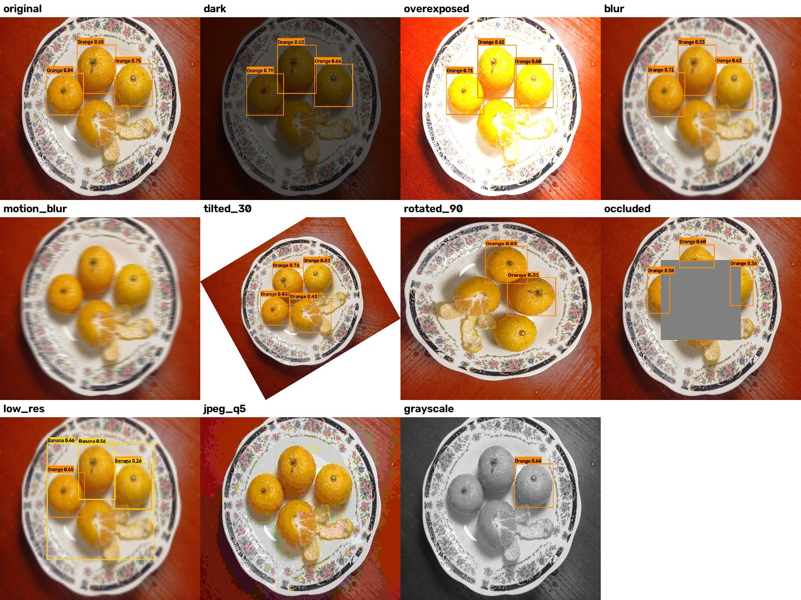

# Checkpoint 3 of 5: Core implementation and testing

**BOTOTOY 2.0: Fruit Detection and Identification Using YOLO** · CSST 106 · BSCS 4A

Team: Kyle Angelo D. Mercado · Ian Patrick Z. Mesias · James Paul L. Panal

> This document was compiled on 20 Nov 2026 from the repository. It maps each item of the checkpoint hand-in
> list to its evidence. The Git history shows when each part was committed.

## Hand-in checklist

| # | Required | Evidence | Status |
|---|---|---|---|
| 1 | Main method integrated in the pipeline | YOLO11n fine-tuned on a Colab T4 ([training report](../../outputs/yolo/training/TRAINING_REPORT.md)), weights `models/trained/bototoy_yolo11n.pt`, wrapped by `src/yolo/detector.py` and `src/inference/image_processor.py` | ✅ |
| 2 | End-to-end pipeline in one command: input → preprocessing → model → post-processing → output | `python -m src.yolo.detector photo.jpg folder/ --out outputs/yolo/demo` (decode → resize → YOLO11n → NMS + confidence filter → annotated images, labels, counts, JSON). Folders: `python -m src.inference.batch_processor folder/ --method yolo` | ✅ |
| 3 | Testing on a fixed set never used for training or tuning, including hard cases, with a test log | Test split (682 images, locked until the final run); 12 unseen Wikimedia photos; [hard-case test log](../../outputs/reports/hard_cases/HARD_CASES.md): 132 cases covering poor lighting, overexposure, blur, motion blur, angle, occlusion, low resolution, compression, grayscale, and clutter in the photos themselves | ✅ |
| 4 | Table comparing baseline vs main method with the right metric, plus laptop speed | Below; full [comparison](../../outputs/comparisons/test/COMPARISON.md) | ✅ |
| 5 | Gallery of ≥ 10 failures grouped by cause, and a confusion matrix | [Error review](../../outputs/yolo/eval_test/error_review/ERROR_REVIEW.md): 1,977 errors sorted by cause, 48 inspected in two galleries; [confusion matrix](../../outputs/yolo/eval_test/ultralytics/confusion_matrix_normalized.png) | ✅ |
| 6 | Improvement plan: top 3 changes, each tied to a failure cause, with the expected result | Below | ✅ |
| — | Results PDF (2–4 pages); tag `cp3-core` | — | ❌ not created |

## Preliminary results: baseline vs YOLO11n

Both methods were run on the same 682 test images and scored with the same metric code. The laptop is an AMD
Ryzen 5 5600U (CPU only).

| Metric | OpenCV baseline | YOLO11n |
|---|---|---|
| mAP@0.50 | 0.049 | **0.486** |
| mAP@0.50:0.95 | 0.031 | **0.336** |
| Precision / recall (operating point) | 0.072 / 0.075 | **0.668 / 0.410** |
| Exact fruit count | 15.8% | **45.0%** |
| Time per image (end-to-end) | **35 ms** | 62 ms (≈ 16 FPS) |

**Hard conditions** (12 unseen photos per condition; a case passes if the expected fruit type is found):

| Condition | YOLO11n | Baseline |
|---|---|---|
| Original | **11/12** | 7/12 |
| Poor lighting (×0.35) | **10/12** | 6/12 |
| Overexposed (×1.8) | **12/12** | 8/12 |
| Gaussian blur | **10/12** | 8/12 |
| Motion blur | 4/12 | **7/12** |
| Rotated 30° / 90° | **11/12 / 12/12** | 6/12 / 6/12 |
| Occlusion (center block) | **9/12** | 6/12 |
| Low resolution (128 px) | **9/12** | 8/12 |
| JPEG quality 5 | 4/12 | **6/12** |
| Grayscale | **8/12** | 0/12 |

YOLO11n is better in 9 of the 11 conditions; the baseline wins on motion blur and heavy compression. The
baseline's passes often come with wrong extra fruit types. Details and every case are in
[HARD_CASES.md](../../outputs/reports/hard_cases/HARD_CASES.md).

## Error analysis (grouped by cause)

| Cause | Share of missed fruits | Example IDs in the gallery |
|---|---|---|
| Fruit inside one box the model drew around the whole group | 49.8% | FN02, FN04, FN08, FN19 |
| Small fruit (< 1% of the image) | 30.0% | FN05, FN07, FN11, FN16 |
| Clearly visible fruit not detected | 15.8% | FN03, FN13, FN14, FN22 |
| Wrong class | 1.4% | — |

| Cause | Share of false positives | Example IDs in the gallery |
|---|---|---|
| Nothing labeled nearby (includes real fruits missing from the labels) | 44.7% | FP12 leaf, FP13 vase, FP14 fried food, FP09 unlabeled bananas |
| One box around a group of labeled fruits | 19.0% | FP05, FP06, FP19 |
| Box poorly placed | 13.7% | FP23 |
| Wrong class | 5.5% | FP10, FP22 |

Galleries: [`sample_fn.jpg`](../../outputs/yolo/eval_test/error_review/sample_fn.jpg),
[`sample_fp.jpg`](../../outputs/yolo/eval_test/error_review/sample_fp.jpg).

From the hard-case test:
- **Motion blur and heavy JPEG compression** remove most detections.
- A **green orange** is called Apple, and **yellow watermelon** is called Apple, because the training data has
  few such examples.
- **Grayscale** apples are missed.

## Improvement plan (top 3)

| # | Change | Failure cause it targets | Expected result |
|---|---|---|---|
| 1 | Relabel crowded scenes in one consistent style (one box per fruit), or remove group-box images from training | Group boxes: 49.8% of misses, 19.0% of false positives | Most of the "covered by group" misses become correct detections. This is the largest possible gain in recall and in counting accuracy. |
| 2 | Train at 960 px and/or with YOLO11s instead of YOLO11n | Small fruits: 30.0% of misses | More small fruits found; still under 1 s per image on the laptop (960 px inference takes about 135 ms with the current model) |
| 3 | Add training augmentation for motion blur, compression and grayscale, and more photos of green citrus and yellow watermelon | Hard-case failures (motion blur 4/12, JPEG 4/12) and color-based confusions | Better robustness to phone-camera conditions; fewer Apple confusions for unusual colors |
