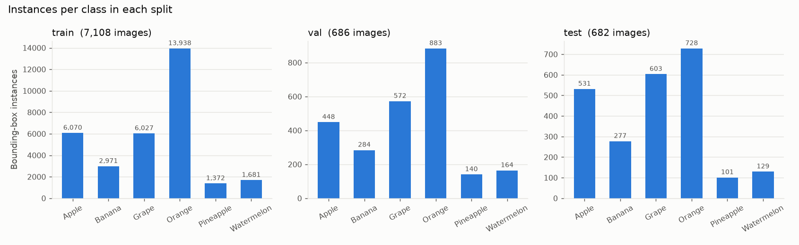
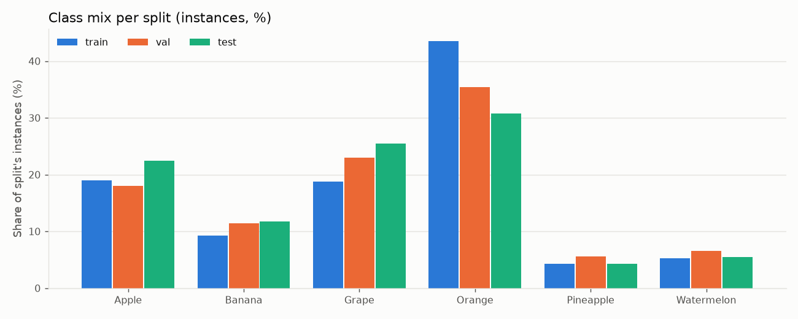
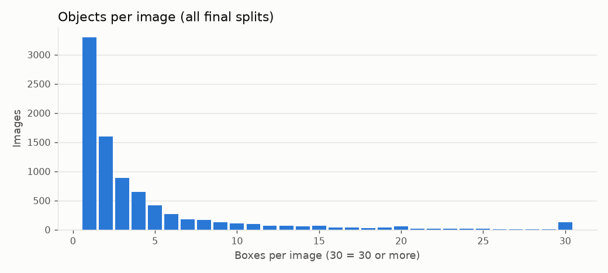
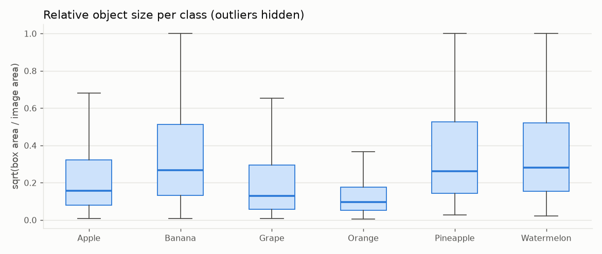
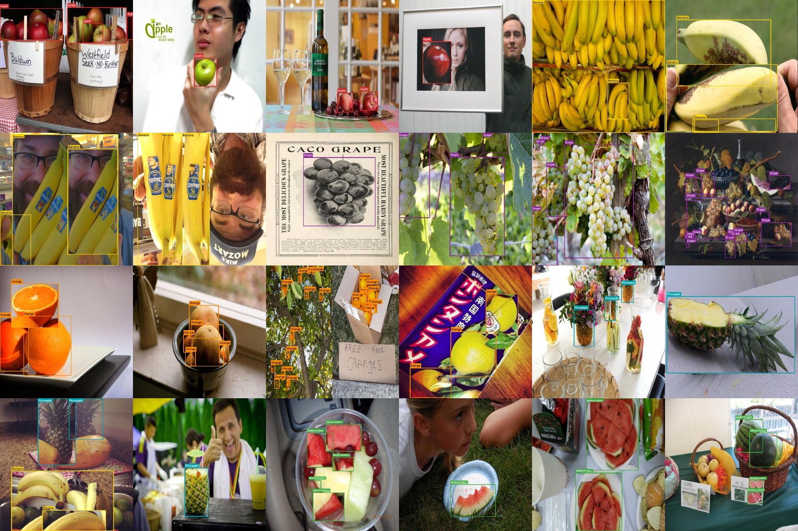

# Dataset Audit Report - BOTOTOY 2.0

_Generated by `src/data/dataset_analyzer.py` on 2026-11-17. All numbers below are computed from the downloaded files._

## 1. Source and license

- **Source used:** GitHub mirror `lightly-ai/dataset_fruits_detection` at commit `e626559d4a127ea9fc35fedd74c52ee9f378a53d`
- **Original source:** Kaggle - https://www.kaggle.com/datasets/lakshaytyagi01/fruit-detection (by Lakshay Tyagi)
- **License:** CC0-1.0 (LICENSE file in the GitHub mirror). The Kaggle page's own license field should be cross-checked by the team when citing.
- **Pre-processing applied by the dataset author (Roboflow export):** auto-orientation, resize to 640x640 (stretch). The training split also contains Roboflow-augmented copies.

## 2. Original structure and data.yaml

- data.yaml: `nc=6`, names = ['Apple', 'Banana', 'Grape', 'Orange', 'Pineapple', 'Watermelon'] -> **matches** config.yaml
- Class ids: 0 = Apple, 1 = Banana, 2 = Grape, 3 = Orange, 4 = Pineapple, 5 = Watermelon

| Original split | Images | Boxes | Unique source photos |
|---|---|---|---|
| train | 7108 | 32059 | 3200 |
| valid | 914 | 3227 | 914 |
| test | 457 | 1636 | 457 |

## 3. Integrity checks

| Check | Result |
|---|---|
| Images checked / boxes parsed | 8479 / 36922 |
| Images without a label file | 0 |
| Label files without an image | 0 |
| Unreadable / corrupt images | 0 |
| Empty label files (background images) | 0 |
| Invalid class ids | 0 |
| Malformed label lines | 0 |
| Coordinates outside [0, 1] | 0 |
| Boxes extending past the image border | 0 |
| Images with duplicate box lines (warning) | 3 |
| Images with a critical issue | 0 |
| Image formats | {'.jpg': 8479} |
| Image sizes | {'640x640': 8479} |
| Color channels | {'3': 8479} |

Duplicate box lines are harmless: Ultralytics removes duplicate labels automatically.

## 4. Duplicates and data leakage

- Unique source photos (from Roboflow file names): **4571**; source photos appearing in more than one original split: **0**
- Exact duplicate files (MD5): 34 groups, 0 across splits (all within-split groups are identical augmented copies of the same training photo)
- Near-duplicates (64-bit dHash, Hamming distance <= 4): 2524 pairs, of which 2499 are augmented copies of the same photo and **5 cross original splits** {'train-valid': 5}
- Cross-split pairs were inspected visually (`near_duplicate_pairs/`): at least one is the same photo with different color processing (true leakage); others are different photos from the same photo series. **All validation images involved were excluded** from the final val/test sets:

  - `valid/images/13aa950e12907f38_jpg.rf.1921893a9ef4902c631e6a8688a4931d.jpg` - near-duplicate of training image (Hamming 4)
  - `valid/images/82c6431f2a0503ae_jpg.rf.35f8968a4db45499f2d2d27025e4c926.jpg` - near-duplicate of training image (Hamming 3)
  - `valid/images/84b032fa9879a0c1_jpg.rf.0c06022465e2e91acf68102f87dbbf82.jpg` - near-duplicate of training image (Hamming 3)

## 5. Final train / validation / test split (Option A)

The original training split is kept unchanged (it contains every augmented copy, so copies can never leak into evaluation). The un-augmented original valid + test images were pooled, leaking images removed, near-duplicates grouped, and groups assigned ~50/50 to val and test, stratified by each group's dominant class (seed 42).

| Split | Images | Image share | Unique photos | Unique-photo share | Boxes |
|---|---|---|---|---|---|
| train | 7108 | 83.9% | 3200 | 70.0% | 32059 |
| val | 686 | 8.1% | 686 | 15.0% | 2491 |
| test | 682 | 8.1% | 682 | 14.9% | 2369 |

**Leakage verification on the final split:** file overlap {'train-val': 0, 'train-test': 0, 'val-test': 0}, MD5 overlap {'train-val': 0, 'train-test': 0, 'val-test': 0}, source-photo overlap {'train-val': 0, 'train-test': 0, 'val-test': 0}, near-duplicate pairs across splits = 0 -> **LEAKAGE-FREE**

The **test split is locked**: it is used only once, for the final evaluation in Phase 4. Model selection and threshold tuning use the val split.

## 6. Class distribution

| Class | Inst. train | Inst. val | Inst. test | Img. train | Img. val | Img. test | Share of all inst. | Median rel. side | Boxes < 1% area |
|---|---|---|---|---|---|---|---|---|---|
| Apple | 6070 | 448 | 531 | 1564 | 153 | 148 | 19.1% | 0.158 | 31.1% |
| Banana | 2971 | 284 | 277 | 1205 | 126 | 126 | 9.6% | 0.266 | 17.7% |
| Grape | 6027 | 572 | 603 | 1453 | 148 | 145 | 19.5% | 0.13 | 40.7% |
| Orange | 13938 | 883 | 728 | 1818 | 146 | 143 | 42.1% | 0.097 | 51.2% |
| Pineapple | 1372 | 140 | 101 | 601 | 58 | 59 | 4.4% | 0.262 | 14.8% |
| Watermelon | 1681 | 164 | 129 | 746 | 79 | 75 | 5.3% | 0.282 | 14.3% |

- Imbalance ratio (most / least frequent class instances): **9.64x**
- Images containing more than one fruit class: 295

| Split | Mean boxes/image | Median | Max |
|---|---|---|---|
| train | 4.51 | 2.0 | 90 |
| val | 3.63 | 2.0 | 66 |
| test | 3.47 | 1.0 | 82 |

## 7. Figures









### Annotated training samples (24 images, 4 per class)



Individual files: `samples/`. Samples come from the training split only (test set stays locked).

## 8. Ultralytics loader check

Ultralytics successfully parsed `data/data.yaml` and loaded every split:

| Split | Images loaded | Boxes loaded | Sample tensor (C,H,W) |
|---|---|---|---|
| train | 7108 | 32059 | [3, 640, 640] |
| val | 686 | 2491 | [3, 640, 640] |
| test | 682 | 2369 | [3, 640, 640] |

## 9. Characteristics and limitations

- **Class imbalance:** Orange has 15,549 instances vs Pineapple with 1,613 (9.64x). Expect lower recall on rare classes; report per-class AP, not only the mean.
- **Augmented training copies:** 7,108 training images come from only 3,200 photos, so the effective training-set diversity is smaller than the image count suggests.
- **Stretched images:** all images were resized to 640x640 without keeping the aspect ratio, so fruit shapes can be distorted. This matters for the OpenCV baseline's shape features (aspect ratio, circularity).
- **Dense, small objects:** grapes and oranges often appear in clusters of many small boxes; overlapping fruits are hard for contour-based methods and for counting.
- **Near-duplicate detection is limited:** dHash catches re-encoded or re-colored copies of the same image, not different shots of the same scene, so some scene-level similarity between splits may remain.
- **Label quality:** automated checks found no invalid labels, but box accuracy and missing annotations were only spot-checked through the sample visualizations, not exhaustively. The spot check of the 24 samples found:
  - **Group boxes:** some boxes cover a whole group of fruits rather than one fruit (e.g. `samples/sample_05_banana.jpg`: one box spans the entire banana display), and some fruits in a group are left unlabeled. Consequently, *fruit count = number of detected boxes*, which can under-count dense piles. This must be stated when presenting counting results.
  - **Varied image types:** paintings, illustrations and framed photos appear alongside real photos (e.g. samples 04, 09, 12).
  - **Possible class noise:** yellow citrus that may be lemons is labeled Orange (`samples/sample_16_orange.jpg`).

## 10. How to reproduce

```bash
python -m src.data.download_dataset      # download pinned dataset to data/raw/
python -m src.data.dataset_validator     # integrity + duplicate checks
python -m src.data.dataset_splitter --from-manifest   # rebuild the committed split
python -m src.data.dataset_analyzer      # statistics, figures, this report
```
