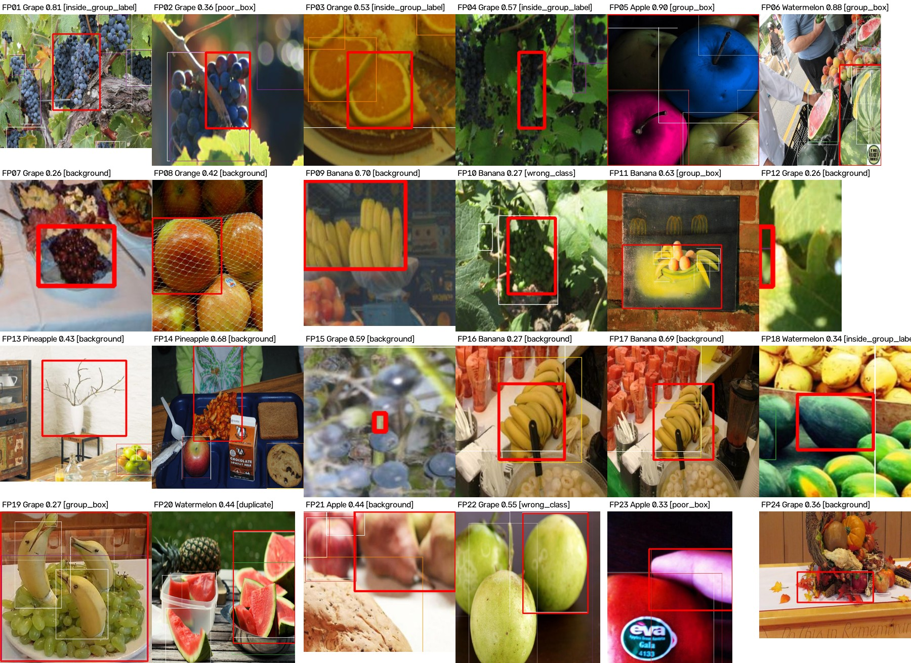
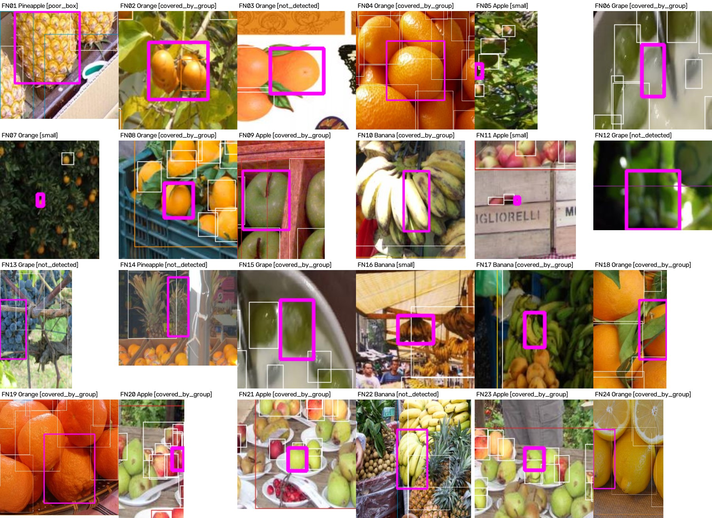

# YOLO11n error review: `test` split

The proposal asks for "a confusion/error review with at least 20 false positives or missed objects".
This review covers **every** error on the locked test split: 416 false positives and 1,561 missed fruits.
Each error was first sorted automatically by its geometry. Then **48 randomly sampled errors** (24 + 24) were
inspected by eye.

- Model: `models/trained/bototoy_yolo11n.pt`, the final model from Phase 4 (unchanged)
- Operating point: confidence ≥ 0.25, NMS IoU 0.7 (the app's default)
- Matching: a prediction is correct if it overlaps a ground-truth fruit of the same class with IoU ≥ 0.5
  (the same rule as `src/utils/metrics.py`)
- Reproduce: `python -m src.evaluation.error_review --split test --final` (about 2 minutes on CPU)

This review describes the errors from the one-time Phase 4 test run. It did not change the model, the thresholds
or any reported metric.

Totals: 682 images, 2,369 ground-truth fruits, 1,224 predictions, 808 correct, **416 false positives**,
**1,561 missed fruits**. These match the Phase 4 evaluation.

## 1. All errors by category (automatic)

### False positives (416)

| Category | Meaning | Count | Share |
|---|---|---|---|
| background | no ground-truth fruit nearby (IoU < 0.1); includes fruits missing from the labels | 186 | 44.7% |
| group_box | the model drew one box around ≥ 2 labeled fruits | 79 | 19.0% |
| poor_box | right fruit, but the box overlaps it with IoU between 0.1 and 0.5 | 57 | 13.7% |
| inside_group_label | single fruits inside a ground-truth box that covers a whole group | 54 | 13.0% |
| wrong_class | box on a real fruit, but with the wrong fruit name | 23 | 5.5% |
| duplicate | second box on a fruit that was already found | 17 | 4.1% |

### Missed fruits (1,561)

| Category | Meaning | Count | Share |
|---|---|---|---|
| covered_by_group | the fruit lies inside a box the model drew around its whole group | 778 | 49.8% |
| small | not detected, and smaller than 1% of the image | 469 | 30.0% |
| not_detected | not detected, normal size | 247 | 15.8% |
| poor_box | found, but the box overlaps it with IoU between 0.1 and 0.5 | 45 | 2.9% |
| wrong_class | found, but with the wrong fruit name | 22 | 1.4% |

### By class

| Class | FP: background | FP: group-related¹ | FP: wrong class | FN: covered by group | FN: small | FN: not detected |
|---|---|---|---|---|---|---|
| Apple | 35 | 27 | 6 | 180 | 112 | 57 |
| Banana | 27 | 14 | 4 | 92 | 26 | 40 |
| Grape | 41 | 40 | 5 | 150 | 169 | 53 |
| Orange | 57 | 34 | 4 | 317 | 154 | 57 |
| Pineapple | 11 | 2 | 1 | 19 | 7 | 18 |
| Watermelon | 15 | 16 | 3 | 20 | 1 | 22 |

¹ group_box + inside_group_label.

The misses are concentrated: 328 of 682 images have at least one miss, and the **20 worst images hold 40.2% of
all misses**. These are crowded crates, trees and market piles.

## 2. Manual review of 48 sampled errors

The sample was drawn at random (seed 42) from all errors, so it reflects the typical error, not the worst
cases. In the contact sheets, the thick box is the error (red = false positive, magenta = missed fruit). Thin
white boxes are ground truth, and thin colored boxes are the model's other predictions.

### False positives: [`sample_fp.jpg`](sample_fp.jpg)

| ID | Prediction | Automatic category | What the image shows | Verdict |
|---|---|---|---|---|
| FP01 | Grape 0.81 | inside_group_label | a real grape bunch, inside a larger labeled grape box | real fruit, labeled as part of a group |
| FP02 | Grape 0.36 | poor_box | a real grape bunch on the vine, inside a larger labeled grape box | real fruit, labeled as part of a group |
| FP03 | Orange 0.53 | inside_group_label | an orange slice on a cake | real fruit, labeled as part of a group |
| FP04 | Grape 0.57 | inside_group_label | a hanging grape bunch | real fruit, labeled as part of a group |
| FP05 | Apple 0.90 | group_box | one box around three (recolored) apples | model error: group box |
| FP06 | Watermelon 0.88 | group_box | one box around a stack of watermelons | model error: group box |
| FP07 | Grape 0.26 | background | a bowl of dark berries | unclear: may be unlabeled grapes |
| FP08 | Orange 0.42 | background | red-yellow fruit in a net bag, no label nearby | unclear: unlabeled fruit, probably apples |
| FP09 | Banana 0.70 | background | bananas on a market stall | real fruit, missing from the labels |
| FP10 | Banana 0.27 | wrong_class | green grapes on the vine | model error: wrong class |
| FP11 | Banana 0.63 | group_box | a painting of a fruit bowl | model error: group box (artwork) |
| FP12 | Grape 0.26 | background | the edge of a leaf | model error: background |
| FP13 | Pineapple 0.43 | background | a vase with bare branches | model error: background |
| FP14 | Pineapple 0.68 | background | fried food on a lunch tray | model error: background |
| FP15 | Grape 0.59 | background | one berry in a labeled bunch | real fruit, labeled as part of a group |
| FP16 | Banana 0.27 | background | bananas at a buffet | real fruit, missing from the labels |
| FP17 | Banana 0.69 | background | bananas at the same buffet | real fruit, missing from the labels |
| FP18 | Watermelon 0.34 | inside_group_label | one fruit inside a labeled group of green fruits | real fruit, labeled as part of a group |
| FP19 | Grape 0.27 | group_box | one box around a whole plate of grapes | model error: group box |
| FP20 | Watermelon 0.44 | duplicate | watermelon slices that another box already found | model error: duplicate box |
| FP21 | Apple 0.44 | background | a loaf of bread next to apples | model error: background |
| FP22 | Grape 0.55 | wrong_class | a large green round fruit labeled Apple | model error: wrong class |
| FP23 | Apple 0.33 | poor_box | an apple, box shifted onto its edge | model error: poor box |
| FP24 | Grape 0.36 | background | autumn table decoration | unclear: probably background |

**Summary of the 24 false positives:**

| Verdict | Count |
|---|---|
| Real fruit, but the labels missed it or counted it as part of a group | **9** |
| Model drew one box around a group | 4 |
| Non-fruit object or background (leaf, vase, fried food, bread) | 4 |
| Wrong fruit class | 2 |
| Poorly placed box | 1 |
| Duplicate box | 1 |
| Unclear | 3 |

The automatic category and the verdict can differ. For example, FP09 and FP16 are "background" by geometry
because no label is nearby, but the image shows real bananas that were never labeled.

### Missed fruits: [`sample_fn.jpg`](sample_fn.jpg)

| ID | Class | Automatic category | What the image shows | Verdict |
|---|---|---|---|---|
| FN01 | Pineapple | poor_box | close-up pineapple, cut off at the image edge | box placement |
| FN02 | Orange | covered_by_group | fruits on a branch, one box around the group | group box |
| FN03 | Orange | not_detected | a clear orange on a white background | **clear miss** |
| FN04 | Orange | covered_by_group | a pile of oranges | group box |
| FN05 | Apple | small | a tiny apple among leaves | small fruit |
| FN06 | Grape | covered_by_group | blurry green grapes, close-up | group box |
| FN07 | Orange | small | a tiny orange on a tree | small fruit |
| FN08 | Orange | covered_by_group | a crate of oranges | group box |
| FN09 | Apple | covered_by_group | green apples in crates | group box |
| FN10 | Banana | covered_by_group | one banana in a bunch | group box |
| FN11 | Apple | small | a tiny, half-visible apple at a crate edge | small fruit |
| FN12 | Grape | not_detected | a dark, blurry green region | unclear: hard to recognize even by eye |
| FN13 | Grape | not_detected | a dark grape bunch on the vine | **clear miss** |
| FN14 | Pineapple | not_detected | a pineapple behind others at a market | **clear miss** (partly hidden) |
| FN15 | Grape | covered_by_group | blurry green grapes in a bowl | group box |
| FN16 | Banana | small | a distant banana bunch at a market | small fruit |
| FN17 | Banana | covered_by_group | a banana in a market pile | group box |
| FN18 | Orange | covered_by_group | an orange half hidden by leaves | group box |
| FN19 | Orange | covered_by_group | a pile of oranges | group box |
| FN20 | Apple | covered_by_group | a half-visible apple in a bowl | group box |
| FN21 | Apple | covered_by_group | a green fruit on a plate of apples and pears | group box |
| FN22 | Banana | not_detected | a banana bunch in a crowded market display | **clear miss** |
| FN23 | Apple | covered_by_group | a green fruit on a plate of apples and pears | group box |
| FN24 | Orange | covered_by_group | yellow **lemons** labeled Orange | group box + label noise |

**Summary of the 24 missed fruits:**

| Verdict | Count |
|---|---|
| Inside a box the model drew around the whole group | **14** |
| Small or distant fruit | 4 |
| Clear miss of a visible fruit | 4 |
| Box placement | 1 |
| Unclear | 1 |

## 3. Conclusions

1. **Fruit names are rarely the problem.** Only 45 of the 1,977 errors (2.3%) are a wrong fruit name. When the
   model finds a fruit, it almost always names it correctly. This agrees with the confusion matrix.
2. **Half of all misses come from group boxes.** 778 missed fruits (49.8%) lie inside a box the model drew around
   their group. The dataset labels piles in both styles, sometimes one box per fruit and sometimes one box per
   group, and the model learned both. Under the IoU ≥ 0.5 rule, one group box makes every single fruit in it a
   miss.
3. **The labels themselves cause some of the "false positives".** In the random sample, 9 of 24 false
   positives were real fruits that the labels left out or counted as part of a group. The true precision is
   therefore higher than the measured 0.668. The size of this effect cannot be measured without relabeling the
   test set.
4. **Small fruits are the second cause.** 469 misses (30.0%) are fruits under 1% of the image area, such as
   oranges on a tree or apples deep in a crate. YOLO11n at 640 px sees each of them as only a few pixels.
5. **Clear misses and real false alarms exist but are fewer.** In the sample, 4 of 24 misses are clearly visible
   fruits the model did not find (for example a clear orange on white), and 4 of 24 false positives are non-fruit
   objects (a leaf, a vase, fried food, bread).
6. **Label noise exists.** Lemons are labeled Orange (FN24, and sample 16 of the dataset audit). Some plates
   labeled Apple also contain pears (FN21, FN23).

**What would help most:** (a) relabel crowded scenes in one consistent style, either one box per fruit or one
box per group; (b) train at a larger image size (for example 960 px) or with a larger model, for small fruits;
(c) add more unaugmented photos of single fruits on varied backgrounds. Training for more epochs is not on this
list: validation mAP stopped improving after about epoch 30 (see the training report).

## Files

| File | Contents |
|---|---|
| `all_errors.csv` | every false positive and missed fruit: image, class, confidence, category, box, area |
| `sample.csv` | the 48 sampled errors (IDs match the contact sheets) |
| `sample_fp.jpg`, `sample_fn.jpg` | contact sheets of the sampled errors |
| `summary.json` | all counts in this report |
