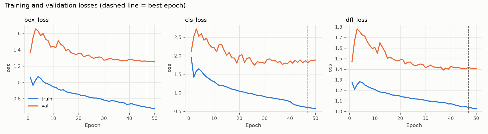
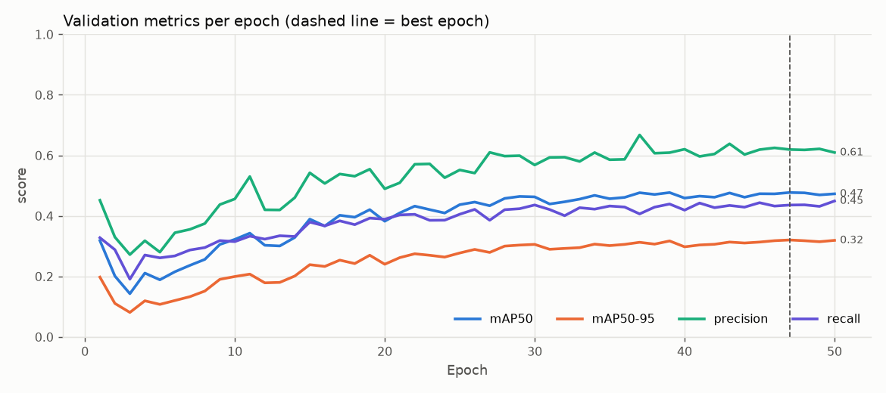

# YOLO11n Training Report - BOTOTOY 2.0

## Configuration

| Setting | Value |
|---|---|
| Model | YOLO11n, transfer learning from COCO-pretrained `yolo11n.pt` |
| Image size | 640 |
| Epochs (max) | 50 |
| Epochs completed | 50 |
| Early-stopping patience | 10 |
| Batch size | 16 |
| Optimizer | SGD, lr0 0.01, momentum 0.937 |
| Seed / deterministic | 42 / True |
| Frozen layers | none (all layers fine-tuned) |
| Augmentation | mosaic 1.0, flip-LR 0.5, HSV h/s/v 0.015/0.7/0.4, scale 0.5 |
| Training duration | 94.3 min of epochs (Ultralytics log); 94.9 min wall-clock for the last session |
| Hardware | Tesla T4 (14.6 GB), CPU Intel(R) Xeon(R) CPU @ 2.00GHz |
| Software | Python 3.13.16, torch 2.14.1+cu130, Ultralytics 8.4.215, CUDA 13.0 |
| Installed weights | `models/trained/bototoy_yolo11n.pt` (5.5 MB, sha256 `6ce708595601…`, verified) |

## Best checkpoint (selected on the validation split)

Best epoch **47** of 50: validation precision 0.619, recall 0.436, mAP50 **0.477**, mAP50-95 **0.320** (values logged during training).

## Curves

Ultralytics' own plots (results, confusion matrix, PR curves, label statistics, training batches) are in `run/`.

