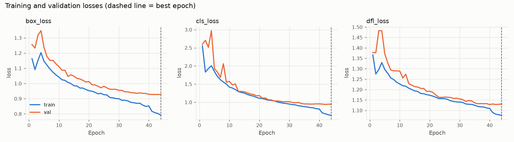
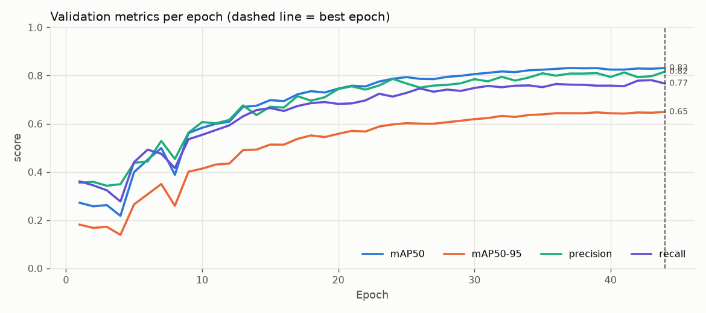

# YOLO11n Training Report - BOTOTOY 2.0

## Configuration

| Setting | Value |
|---|---|
| Model | YOLO11n, transfer learning from COCO-pretrained `yolo11n.pt` |
| Image size | 640 |
| Epochs (max) | 50 |
| Epochs completed | 44 |
| Early-stopping patience | 10 |
| Batch size | 16 |
| Optimizer | SGD, lr0 0.01, momentum 0.937 |
| Seed / deterministic | 42 / True |
| Frozen layers | none (all layers fine-tuned) |
| Augmentation | mosaic 1.0, flip-LR 0.5, HSV h/s/v 0.015/0.7/0.4, scale 0.5 |
| Training duration | 125.2 min of epochs (Ultralytics log) |
| Hardware | Google Colab, NVIDIA Tesla T4 GPU (free tier) |
| Software | Ultralytics 8.4.215 (pinned in the notebook); exact Python/torch/CUDA versions not recorded (see note) |
| Installed weights | `models/trained/bototoy_fruit31_yolo11n.pt` (5.5 MB after removing the optimizer state, sha256 `57a494b3f0af…`) |

**Note - training stopped early.** The free Colab GPU quota ran out during epoch 45 of 50, so the notebook's
final step (which records the system details and the weights checksum) never ran. The run folder was downloaded
from Google Drive and `best.pt` (best validation epoch, 44) was used. Validation mAP50 had been flat at about
0.83 since epoch 37, so the missing epochs would have changed little. The weights checksum could not be compared
with one recorded on Colab; the value above is the installed file's own checksum.

## Best checkpoint (selected on the validation split)

Best epoch **44** of 44: validation precision 0.816, recall 0.767, mAP50 **0.831**, mAP50-95 **0.649** (values logged during training).

## Curves

Ultralytics' own plots (results, confusion matrix, PR curves, label statistics, training batches) are in `run/`.

